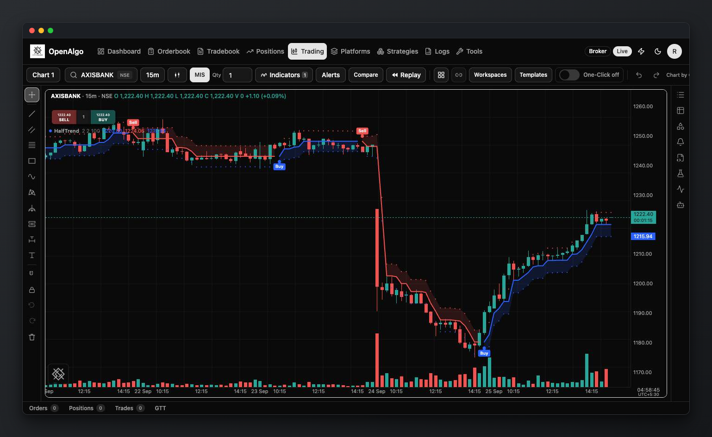
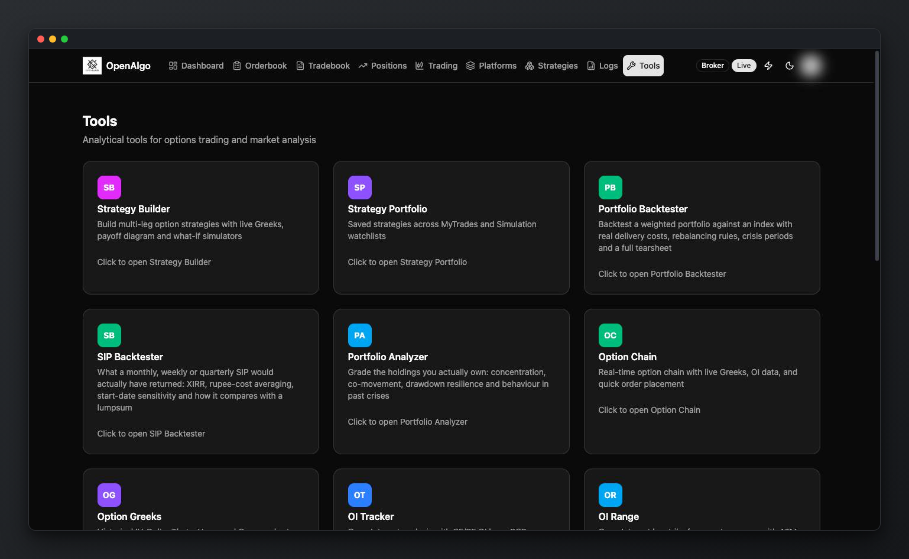
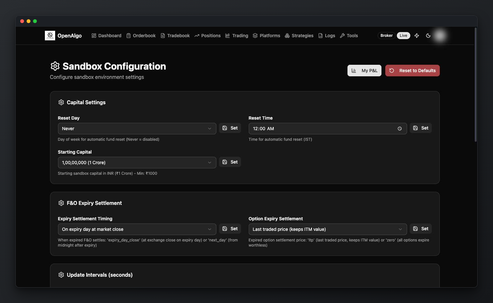
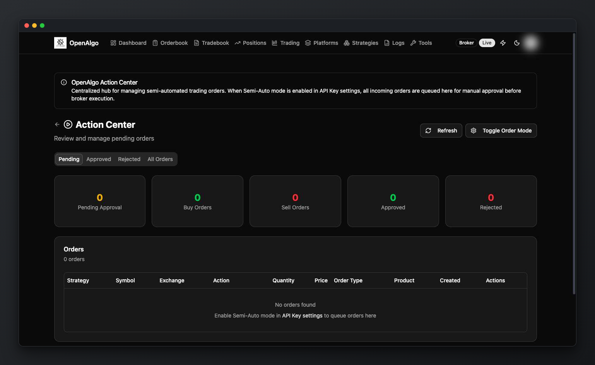

# What is OpenAlgo?

**OpenAlgo is the open source trading ecosystem for everyone.** It is one all-in-one platform that you host yourself: chart and trade, scalp, analyse options, automate strategies with code or without it, manage risk, test in sandbox mode and research your own market data, all on one screen and across 37 broker plugins.

You do not need a separate charting subscription, an options analytics tool, an algo bridge and a backtester stitched together. They are all part of the same self-hosted stack, they share one broker session and one real-time market feed, and the code, the data and the server stay yours.

Under the hood, OpenAlgo is built with Python Flask and a modern React frontend. It provides a unified API layer across 37 broker plugins: 35 securities brokers, Delta Exchange for crypto derivatives, and a Dhan sandbox plugin for testing without real money. It accepts signals from Amibroker, TradingView, GoCharting, N8N, ChartInk, MetaTrader 5, Excel, Google Sheets, and a Chrome extension, and ships eight official SDKs: Python, Node.js, Java, .NET, Go, Rust, R, and MATLAB.



***

### One Platform, Many Desks

OpenAlgo began as a bridge between trading signals and broker APIs. That execution layer is now one part of a complete trading desk:

| Desk | What it does for you | Learn more |
| --- | --- | --- |
| **Algo execution** | One unified broker API and execution engine, driven from TradingView, Amibroker, ChartInk, Excel, Python, or an AI assistant | [API Documentation](api-documentation/v1/README.md) |
| **Charting** | A chart trading terminal with up to eight charts, indicators, drawings and order entry from the chart itself | [Chart Trading Terminal](new-features/trading-terminal.md) |
| **Scalping** | A keyboard-driven terminal with server-side stop, target and trailing that survive a closed browser | [Scalping Terminal](new-features/fast-scalper.md) |
| **Options** | 18 analytics tools: strategy builder, option chain, Greeks, OI, max pain, vol surface, GEX and more | [Analytics and Options Tools](analytics-and-options-tools.md) |
| **No-code strategies** | Flow, a drag-and-drop canvas with 61 node types from triggers to indicators, conditions and orders | [Flow](new-features/flow-visual-strategy-builder.md) |
| **Coded strategies** | Upload a Python script and OpenAlgo runs it on an exchange-aware schedule, with live logs | [Python Strategy Hosting](new-features/python-strategy-hosting.md) |
| **Risk management** | Multi-leg option baskets and signal-driven legs with per-leg stop, target and trailing, overall MTM stop and target, lock-profit and daily loss limits | [Strategy RMS Engine](new-features/strategy-rms-engine.md) |
| **Sandbox testing** | Analyzer mode runs any strategy on live market data with sandbox capital, isolated from your real account | [Sandbox](#sandbox-testing-environment) |
| **AI trading agent** | A chat and voice agent that reads your market data, draws charts and computes indicators; every order it proposes waits for your approval | [Agent](new-features/agent/README.md) |
| **Market data** | Historify stores broker history locally for charts, research, backtests and CSV or Parquet exports | [Historify](new-features/historify.md) |
| **Investing** | Portfolio backtester, portfolio analyzer and SIP backtester | [Portfolio Backtester and Analyzer](new-features/portfolio-analytics.md) |

***

### The Ecosystem Around the Platform

OpenAlgo is more than the application you install:

* **SDKs and integrations** in eight languages and for the tools traders already use, collected in the [Mini FOSS Universe](mini-foss-universe.md).
* **AI tools**: connect Claude, ChatGPT, Cursor and other assistants to your account through the [MCP server](mcp/README.md), or give them ready-made trading [Skills](skills/README.md) for charting, scanning and backtesting.
* **Free learning**: market and trading courses on [openalgo.in/learn](https://openalgo.in/learn), from fundamentals to options, Python and quant.
* **An open community**: everything is AGPL-3.0 licensed, developed in public, and shaped by the traders who use it. See [Community Support](community-support.md).

***

### What Problem Does OpenAlgo Solve?

Most traders end up paying for, and juggling, several disconnected tools: one to chart, one to analyse options, one to send alerts to the broker, another to backtest, and a spreadsheet to tie it together. Each has its own login, its own data and its own limits, and none of them is yours. OpenAlgo puts all of it in one place you control.

It is also built for building. AI agentic coding tools such as Codex, Claude Code, Antigravity, and OpenCode understand OpenAlgo directly, so instead of learning multiple broker APIs you can create strategies, indicators, custom alerts and dashboards faster, store historical data, and run analytics or backtests in a fully self-hosted environment.

Most brokers expose their own APIs with different authentication methods, order parameters, market data structures, and operational limitations. OpenAlgo reduces this friction with common request and response shapes. Exchange coverage, authentication, market-data entitlement, GTT support, and other optional capabilities still vary by plugin and broker account.



***

### Who Is OpenAlgo For?

OpenAlgo is for everyone who trades or invests, whatever their style or experience.

#### Traders

* **Discretionary and chart traders** who want to chart and place orders from one screen
* **Options traders** who want the chain, Greeks, OI and payoff analysis next to execution
* **Scalpers** who want keyboard speed with server-side protection
* **Algo traders** who want to automate TradingView, ChartInk or Amibroker alerts, or run Python and no-code strategies
* Anyone who wants to test safely in sandbox mode and monitor orders, positions, and profit and loss in real time, with full control over execution and data

No coding expertise is required to get started, though advanced users can extend it further.

#### Investors

* Backtest a portfolio allocation or a SIP before committing money
* Analyse how current holdings would have behaved over past markets

#### Developers and Quants

* A stable and well-documented REST and WebSocket API
* Uniform request and response formats across brokers
* SDKs in eight programming languages
* A self-hosted, extensible trading backend with local historical data
* Support for advanced use cases such as AI-driven execution

#### Learners

* Free courses on [openalgo.in/learn](https://openalgo.in/learn), and a sandbox mode to practise with live market data and no real money



***

### Key Capabilities

#### Unified Trading API

OpenAlgo exposes a standardized API that allows you to:

* Place, modify, and cancel orders
* Fetch positions, holdings, and funds
* Access orderbook and tradebook
* Retrieve real-time and historical market data

Broker plugins follow the common API structure for the operations they support.

***

#### Multiple Ways to Run Strategies

OpenAlgo supports different strategy workflows:

* **Hosted Python strategies** running directly inside OpenAlgo as separate processes, on an exchange-aware schedule
* **Visual Flow strategies** built from 61 node types on a no-code canvas, with schedule, price-alert, webhook, and order-update triggers
* **External signals** from TradingView, Amibroker, ChartInk, GoCharting, MetaTrader 5, N8N, Excel, or Google Sheets
* **AI agents** connected through the built-in MCP server over local stdio or an OAuth-protected remote HTTP transport

This flexibility allows users to choose the approach that best fits their experience level.

***

#### Portfolio Analysis

OpenAlgo includes two authenticated, read-only portfolio workflows:

* **Portfolio Backtester** simulates a target NSE/BSE allocation using Historify or broker history, with rebalancing, drift bands, costs, benchmarks, robustness analysis, and a downloadable HTML tearsheet.
* **Portfolio Analyzer** loads current broker holdings and evaluates how today's market-value allocation would have behaved over a selected historical lookback.

Neither workflow places or modifies orders. See [Portfolio Backtester and Analyzer](new-features/portfolio-analytics.md).

***

#### Chart Trading Terminal

The `/trading` terminal provides seven persisted layouts, from a single chart to an eight-chart `4×2` grid. Each pane supports its own symbol, interval, chart type, indicators, drawings, history backfill, market depth, and order entry while sharing one drawing toolbar and the application's real-time market-data connection.

<figure><figcaption></figcaption></figure>

See [Chart Trading Terminal](new-features/trading-terminal.md).

***

#### Scalping Terminal

The `/scalping` workspace is keyboard driven. Arrow keys fire call and put orders, F6 flattens every scalping position, and F7 cancels every pending scalping order. A server-side risk monitor evaluates stops, targets, and trailing steps on live ticks, so protection survives closing the browser.

See [Scalping Terminal](new-features/fast-scalper.md).

***

#### Options and Analytics Tools

The `/tools` page collects 18 analytical surfaces:

* strategy builder and strategy portfolio;
* portfolio backtester, portfolio analyzer, and SIP backtester;
* option chain, option Greeks, and option symbol resolution;
* OI tracker, OI range, OI profile, and max pain;
* straddle chart and straddle PnL;
* volatility surface, IV smile, GEX dashboard, and gamma density;
* a futures arbitrage scanner.

Coverage of a given underlying still depends on the active broker's option-chain and history entitlement.

<figure><figcaption></figcaption></figure>

***

#### Sandbox Testing Environment

OpenAlgo includes a fully isolated **sandbox testing environment** for validating strategies before live deployment.

Sandbox testing provides:

* Live market data
* Configurable **sandbox capital**
* Configurable sandbox margin and order behavior
* Configurable MIS square-off schedules
* Simulated order and account state isolated from live broker execution

<figure><figcaption></figcaption></figure>

***

#### Order Control and Safety

OpenAlgo offers optional order approval workflows:

* Automatic execution for fully automated strategies
* Manual approval for supervised or discretionary trading
* Full audit trail of all actions

This helps reduce execution risk and improves transparency.

<figure><figcaption></figcaption></figure>

***

#### Security and Privacy

Security and data ownership are core principles of OpenAlgo:

* Broker session tokens are encrypted; `.env` credentials must be protected by the operator
* Passwords are securely hashed
* TOTP two-factor authentication can be enforced independently for dashboard sign-in, remote MCP authorization, and password reset
* API access is rate-limited, and traffic and latency are logged locally
* No user data is collected or shared

All data remains on infrastructure controlled by the user.

***

### Deployment and Usage

OpenAlgo is designed to be self-hosted:

* Run on a local machine
* Deploy on a VPS or cloud server
* Suitable for personal, professional, and team use

Once installed, it is your whole trading desk: charting, options analytics, execution, automation and risk management in one place, on infrastructure you control.

### What OpenAlgo is NOT

Let's be clear about what OpenAlgo doesn't do:

| Misconception         | Reality                                              |
| --------------------- | ---------------------------------------------------- |
| Get-rich-quick scheme | It's a tool - profitability depends on your strategy |
| Strategy provider     | You need your own trading ideas                      |
| Financial advisor     | You're responsible for trading decisions             |
| Black box             | 100% open source - verify every line of code         |
| Cloud service         | Self-hosted - you control everything                 |

### System Requirements

| Component   | Minimum                               | Recommended                  |
| ----------- | ------------------------------------- | ---------------------------- |
| **OS**      | Windows 10, macOS 10.15, Ubuntu 20.04 | Latest versions              |
| **Python**  | 3.12+                                 | 3.12+                        |
| **RAM**     | 2 GB                                  | 2 GB+                        |
| **Storage** | 2 GB                                  | 10 GB+ (for historical data) |
| **Network** | Stable internet                       | Low latency connection       |

### Summary

| Aspect                | OpenAlgo                                         |
| --------------------- | ------------------------------------------------ |
| **Cost**              | Free (Open Source, AGPL License)                 |
| **Brokers**           | 37 plugins: 35 securities brokers, Delta Exchange (crypto), Dhan Sandbox |
| **Exchanges**         | NSE, NFO, BSE, BFO, MCX, CDS, BCD, NCDEX, NCO, plus index and crypto segments |
| **SDKs**              | Python, Node.js, Java, .NET, Go, Rust, R, MATLAB |
| **Signal Sources**    | TradingView, Amibroker, ChartInk, GoCharting, MetaTrader 5, N8N, Excel, Google Sheets, Python, AI agents |
| **Trading Surfaces**  | Chart trading terminal, scalping terminal, options tools |
| **Strategy Building** | Flow (61 visual node types), Python Hosting, External Webhooks |
| **Risk Management**   | Strategy RMS Engine: per-leg and overall MTM stop, target, trailing and daily loss limits |
| **AI**                | Built-in trading agent, MCP server, Skills for AI assistants |
| **Sandbox Trading**   | Analyzer Mode with ₹1 Crore sandbox capital      |
| **Historical Data**   | Historify with DuckDB storage                    |
| **Real-Time Data**    | WebSocket streaming for quotes, depth, and order updates |
| **Options Analytics** | 18 tools at `/tools`                             |
| **Notifications**     | Telegram bot, WhatsApp bot, WebSocket updates    |
| **Data Privacy**      | 100% - self-hosted on your infrastructure        |
| **Learning**          | Free courses on [openalgo.in/learn](https://openalgo.in/learn) |
| **Skill Required**    | Basic trading knowledge                          |

***
