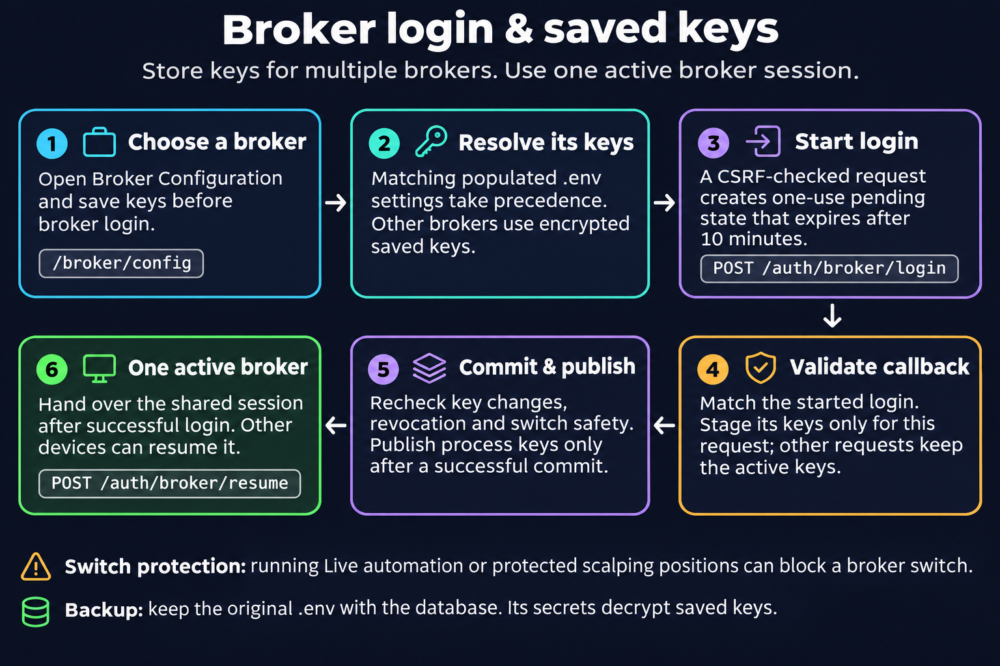

# Broker Configuration and Login

OpenAlgo can save keys for several brokers and connect to one broker at a time. Start with **Select Broker** (`/broker`) after signing in. Use **Configure** on a broker card, **Broker Configuration** at the top of that page, or **Profile > Broker** to open `/broker/config`.

You can configure the first broker before any broker session is connected. There is no need to edit a source file or rebuild the frontend.

<figure><figcaption></figcaption></figure>

## Add Keys

1. Choose the broker in Broker Configuration.
2. Enter the fields shown for that broker. Field names and hints follow the broker's terminology, such as API Key, App ID or client ID.
3. If the broker redirects back to OpenAlgo, register the exact Redirect URL shown on this page in its developer console.
4. Choose **Save**, return to Select Broker, and choose **Login with <broker>**.
5. Complete the login described on the card, then verify funds and the order/position books before starting automation.

The broker-specific [setup guides](brokers/README.md) explain developer-app registration and credential formats. Their `.env` examples are an optional compatibility path; the same supported fields can be entered in Broker Configuration.

Saved keys are encrypted in the database. The page shows a partial API-key identifier and whether secrets are saved, rather than displaying saved secrets. Database-saved changes apply without a restart. **Forget this broker** removes its saved keys; to remove just one optional key, forget the broker and save the keys you still need again.

Some adapter-specific settings, such as `BROKER_CLIENT_ID` for HDFC Sky or `BROKER_VENDOR_CODE` for Motilal Oswal, remain `.env` settings. Follow the broker page and the configuration hints for those fields.

## Existing `.env` Keys Come First

When `REDIRECT_URL` names a broker and `BROKER_API_KEY` is set in `.env`, that broker uses the `.env` keys first. Saved database keys serve the other brokers, and all brokers when `.env` selects none.

| Setting | Purpose |
|---|---|
| `BROKER_API_KEY`, `BROKER_API_SECRET` | Broker-specific key/secret or combined identifier |
| `BROKER_API_KEY_MARKET`, `BROKER_API_SECRET_MARKET` | Separate market-data credentials where the adapter uses them |
| `REDIRECT_URL` | Identifies the `.env` broker and its callback URL |
| `VALID_BROKERS` | Comma-separated plugin allowlist shown by the broker pages |

`BROKER=...` is not the broker selector. Saving keys for the `.env` broker in Broker Configuration updates `.env`; that broker cannot be forgotten from the page. Other brokers' keys are stored in the database.

To move an existing broker off `.env`:

1. Keep a private backup of its key values and your existing `.env`.
2. Empty `REDIRECT_URL`, `BROKER_API_KEY` and `BROKER_API_SECRET`, then restart OpenAlgo. Clear its optional market-key lines too if you are moving those credentials.
3. Sign in, choose the broker in Broker Configuration, enter its keys and save.

Keep the installation's security keys unchanged during this move. `APP_KEY`, `API_KEY_PEPPER` and `FERNET_SALT` are not broker credentials. Never replace the pepper or salt on a populated installation without its migration; back up `.env` with the database so stored credentials remain readable.

## New Installations

The official installers leave broker fields empty, and a first `uv run app.py` without `.env` creates one with unique security keys and no configured broker. Create the administrator account, sign in, and add broker keys in the UI.

If an existing database is present but `.env` is missing, restore its matching `.env`; do not create replacement encryption keys. See [Getting Started](../getting-started/README.md) and [Upgrade](../getting-started/upgrade.md).

## Complete Login From OpenAlgo

Start every broker login from its Select Broker card. OpenAlgo starts it on the server and accepts its answer only for a started login, within ten minutes and only once. Use the same OpenAlgo address as the registered redirect URL: `localhost` and `127.0.0.1` are different browser sites.

The broker already connected keeps using its own keys while a new login runs. New keys become active only when the new login completes. If a login is refused as not started from OpenAlgo or taking too long, sign in and start it again from the card.

## Switching Brokers

Choose **Login with** on another broker's card and confirm the switch. The old session ends only after the new login succeeds; a failed or abandoned login leaves it connected. The switch affects other devices too. Their old sessions end and they must sign in again. Open orders and positions remain at the old broker; they do not move with your OpenAlgo session.

OpenAlgo refuses a switch while relevant live automation remains active: Live strategy-module runs, Live OpenScript runs and, outside analyzer mode, running Python strategies or scalping protection. Logging out does not stop them. After logout, the last broker still counts for this check; reconnecting to that same broker is allowed.

Changing or forgetting the active broker's keys ends its session and asks for confirmation. Reconcile its positions and stop relevant automation before changing credentials or switching. Use separate OpenAlgo instances, ports, databases and supervision when you need concurrent broker sessions.

## Sessions and Reconnection

- Application sign-in and broker-token validity are separate. When only the broker token expires, reconnect from Select Broker.
- Logging out of a broker-connected session, changing the password or resetting it ends application sign-ins on every device.
- Logging out before connecting any broker ends pre-broker sign-ins while leaving devices already on the shared broker session connected.
- A login begun before logout, password change or a change to its broker keys cannot complete afterward.
- The default daily application session expiry is 03:00 IST. Broker token lifetimes and crypto session policies can differ.

The **Active / Open Dashboard** card can also join the valid broker session already opened from another device. Verify the active broker and execution mode before placing an order.
