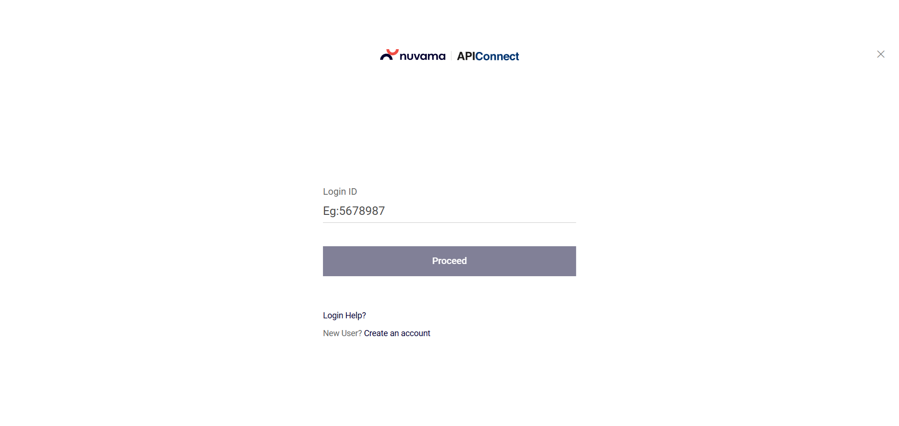
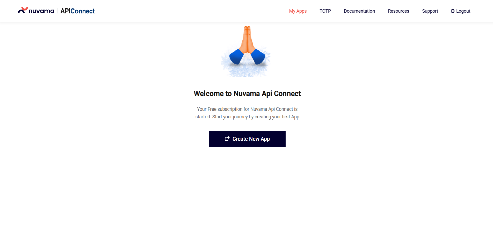
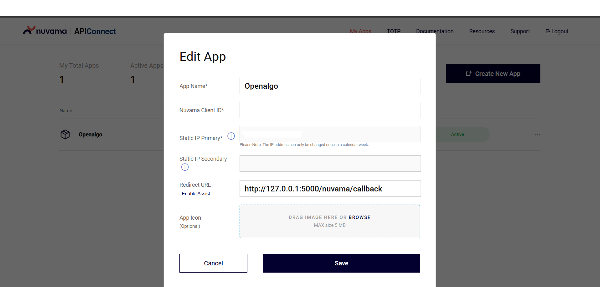
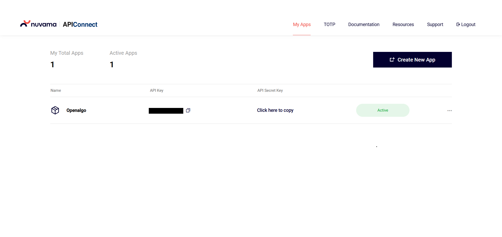

# Nuvama

Nuvama Wealth is an Indian stockbroker. Its API Connect platform lets you place and manage orders, read your positions, holdings and funds, and stream live market data and order updates, which makes it a good fit for algorithmic trading through OpenAlgo.

Nuvama signs you in through its own login page. You register OpenAlgo's redirect URL on your API Connect app, and when you click **Login with Nuvama** in OpenAlgo you log in on Nuvama's page with your Login ID, password and OTP. Nuvama then sends you back to OpenAlgo with the day's session.

**Generating API Key and API Secret**

1. Log in to the Nuvama API Connect portal with your Nuvama **Login ID**, then complete the password and OTP steps.

<figure><figcaption></figcaption></figure>

2. On **My Apps**, click **Create New App**. A new account starts with a free API Connect subscription.

<figure><figcaption></figcaption></figure>

3. Enter an **App Name** you will recognise later, for example `OpenAlgo`.
4. Enter your **Nuvama Client ID**.
5. Enter the static public IP of the machine that runs OpenAlgo as **Static IP Primary**. **Static IP Secondary** is optional.
6. Enter the **Redirect URL** exactly as OpenAlgo uses it: `http://127.0.0.1:5000/nuvama/callback`, or `https://yourdomain.com/nuvama/callback` on a server.

<figure><figcaption></figcaption></figure>

7. Click **Save**. The app appears under **My Apps** with status **Active**.
8. Copy the **API Key** with the copy icon, and the **API Secret Key** with **Click here to copy**.

<figure><figcaption></figcaption></figure>


**Register your static IP before placing orders.** Nuvama accepts orders only from the static IP registered on your app, and the Primary IP can be changed only once per calendar week, so enter it carefully. Run OpenAlgo from that IP.


Then store the key and secret in your `.env` file, and add `nuvama` to `VALID_BROKERS` if it is not already listed. The `REDIRECT_URL` must be the same address you registered on your Nuvama app.

```
BROKER_API_KEY = 'your_nuvama_api_key_here'
BROKER_API_SECRET = 'your_nuvama_api_secret_here'
REDIRECT_URL = 'http://127.0.0.1:5000/nuvama/callback'
```
