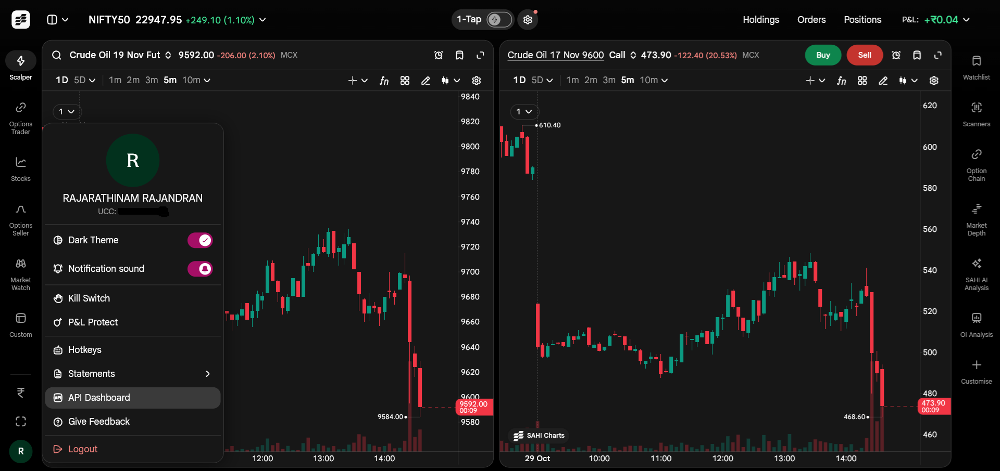
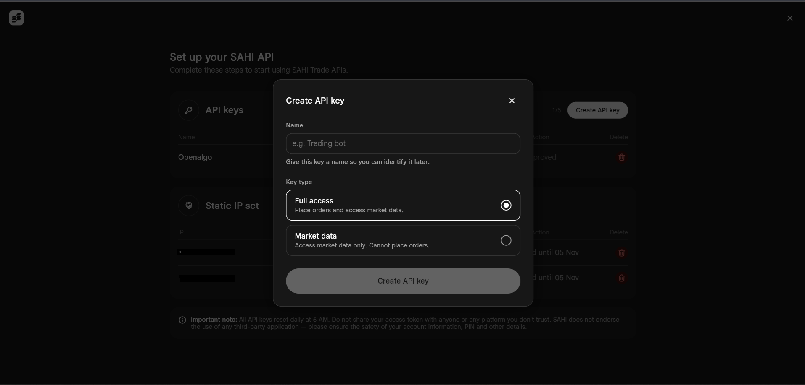

# Sahi

Sahi is an Indian online stock trading platform. Its Direct API lets you place and manage orders, read your positions, holdings and funds, and stream live market data, which makes it a good fit for algorithmic trading through OpenAlgo.

Sahi signs you in with an API key and secret, not an OAuth login. There is no redirect URL to register with Sahi, no TOTP and nothing to type when you log in: OpenAlgo exchanges your saved key and secret for the day's access token.

<figure><figcaption></figcaption></figure>

#### Generating API Key and API Secret

1. Open Sahi web, click your **profile avatar** (bottom left) and choose **API Dashboard**.

<figure><figcaption></figcaption></figure>

2. Click **Create API key**. Complete two-factor verification if asked.
3. Enter a **Name** you will recognise later, for example `OpenAlgo`.
4. Choose the **Access**: pick **Full access** (orders and market data). A **Market data** key cannot place orders.

<figure><figcaption></figcaption></figure>

5. Click **Create API key**.
6. Copy the **API key** (starts with `pk_`) and the **API secret** (starts with `sahi_sk_`). The secret is shown only once.
7. Tick **I have saved my credentials** and click **Done**.


**Register your static IP before placing orders.**  In the API Dashboard click **Add static IP**, enter it as the **Primary IP address** and save. Sahi refuses orders from any other IP. The slot stays locked for 7 days after you set it, and one IP can belong to only one Sahi account. Market data works without a registered IP.



**Approve the key every trading day.** After 6:00 AM IST the key shows **Expired** in the API Dashboard. Click **Approve** on it before you log in to OpenAlgo; until you do, Sahi will not issue a token and the OpenAlgo login fails with a message asking you to approve the key. A key created today is already approved. Sahi's access tokens also expire at 6:00 AM IST, so log in to OpenAlgo once each trading day.


Then store the key and secret in your `.env` file, and add `sahi` to `VALID_BROKERS` if it is not already listed. The `REDIRECT_URL` is not registered anywhere at Sahi; OpenAlgo uses it only to know which broker you use.

```
BROKER_API_KEY = 'pk_your_key_id_here'
BROKER_API_SECRET = 'sahi_sk_your_secret_here'
REDIRECT_URL = 'http://127.0.0.1:5000/sahi/callback'
```
