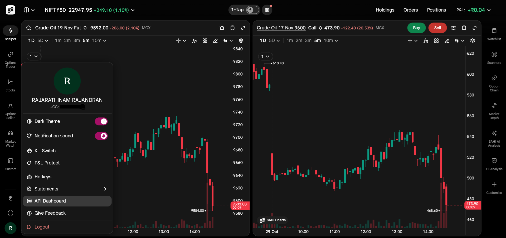
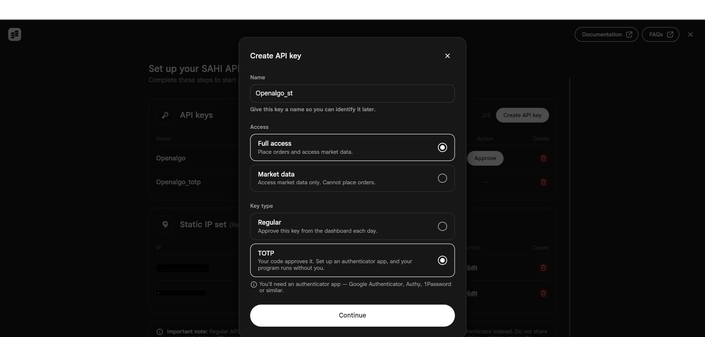
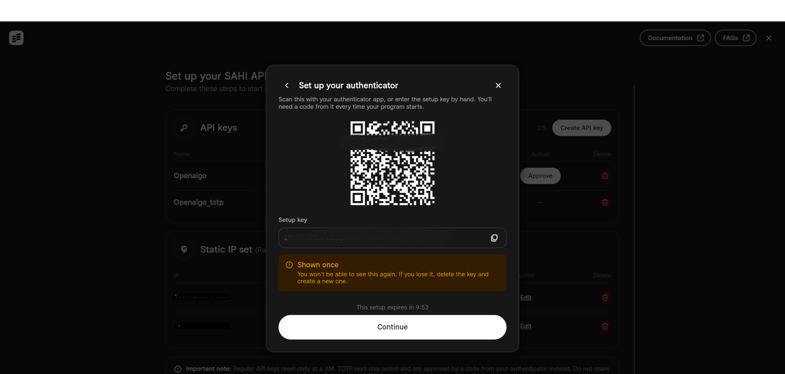

# Sahi


Use [Broker Configuration and Login](../broker-configuration.md) to save these credentials in OpenAlgo and connect the broker. The `.env` examples below remain supported; `.env` keys for the selected broker take precedence over database-saved keys.


Sahi is an Indian online stock trading platform. Its Direct API lets you place and manage orders, read your positions, holdings and funds, and stream live market data, which makes it a good fit for algorithmic trading through OpenAlgo.

Sahi signs you in with an API key and secret, not an OAuth login, and there is no redirect URL to register with Sahi. **Login with Sahi** opens a short form in OpenAlgo with one optional field, **TOTP code**. For a TOTP key, type the 6-digit code your authenticator app shows; for a Regular key, leave it blank. OpenAlgo exchanges your saved key and secret, with the code when you give one, for the day's access token. The code is used once and never saved.

<figure><figcaption></figcaption></figure>

#### Generating API Key and API Secret

1. Open Sahi web, click your **profile avatar** (bottom left) and choose **API Dashboard**.

<figure><figcaption></figcaption></figure>

2. Click **Create API key**. Complete two-factor verification if asked.
3. Enter a **Name** you will recognise later, for example `OpenAlgo`.
4. Choose the **Access**: pick **Full access** (orders and market data). A **Market data** key cannot place orders. Then choose the key type:
   * **TOTP**: the key approves itself each day when you type its code at login. Add the TOTP secret Sahi shows to your authenticator app.
   * **Regular**: the key has to be approved in the API Dashboard every trading day before you log in.

<figure><figcaption></figcaption></figure>

<figure><figcaption></figcaption></figure>

5. Click **Create API key**.
6. Copy the **API key** (starts with `pk_`) and the **API secret** (starts with `sahi_sk_`). The secret is shown only once.
7. Tick **I have saved my credentials** and click **Done**.


**Register your static IP before placing orders.** In the API Dashboard click **Add static IP**, enter it as the **Primary IP address** and save. Sahi refuses orders from any other IP. The slot stays locked for 7 days after you set it, and one IP can belong to only one Sahi account. Market data works without a registered IP.



**A Regular key is approved every trading day.** After 6:00 AM IST it shows **Expired** in the API Dashboard. Click **Approve** on it before you log in to OpenAlgo; until you do, Sahi will not issue a token and the OpenAlgo login fails with a message asking you to approve the key. A key created today is already approved. A TOTP key needs no approval: type its current code on the login form instead. Sahi's access tokens expire at 6:00 AM IST, so log in to OpenAlgo once each trading day with either key type.


Then store the key and secret in your `.env` file, and add `sahi` to `VALID_BROKERS` if it is not already listed. The `REDIRECT_URL` is not registered anywhere at Sahi; OpenAlgo uses it only to know which broker you use.

```
BROKER_API_KEY = 'pk_your_key_id_here'
BROKER_API_SECRET = 'sahi_sk_your_secret_here'
REDIRECT_URL = 'http://127.0.0.1:5000/sahi/callback'
```
