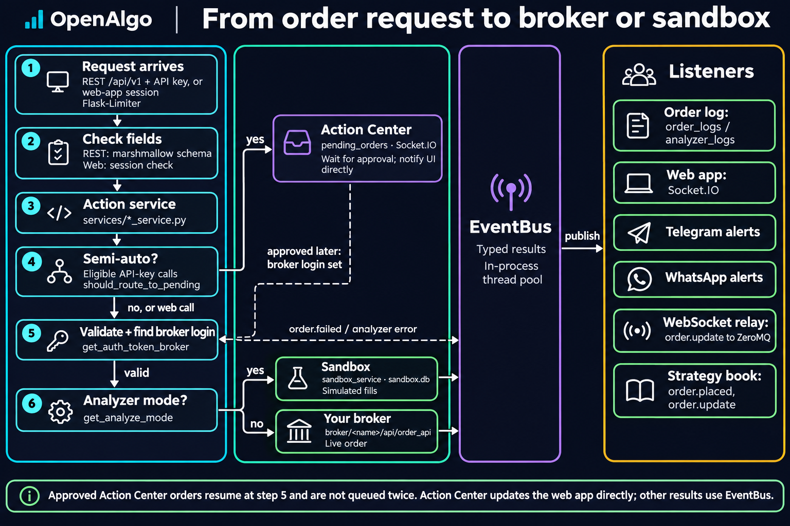

# 02 - Backend Architecture

## Overview

OpenAlgo uses Flask 3.1 with Flask-RESTX, Flask-SocketIO, Flask-Limiter, Flask-WTF CSRF, SQLAlchemy, APScheduler, DuckDB, ZeroMQ, and a separate asyncio WebSocket proxy. Python `>=3.12` is required.

The backend is a single-user application. Production requires exactly one Gunicorn worker process (`-w 1`) because Socket.IO and other application state live in that process. Eventlet is the default; `OPENALGO_WORKER_CLASS='gthread'` opts into 64 request threads through the supplied launcher. `uv run app.py` uses standard threading and ignores that setting. See [worker selection and rollback](../../getting-started/gthread-migration.md).

The market-data proxy runs in a child process under either Gunicorn worker, or separately through Docker `start.sh`. Process-local caches and the EventBus are not shared across processes. Market data and selected cache invalidations use ZeroMQ.

## Request Surfaces

| Surface | Registration | Authentication |
|---|---|---|
| REST v1 | `restx_api/__init__.py`, prefix `/api/v1` | OpenAlgo API key; CSRF exempt |
| Session APIs and webhooks | `blueprints/*.py` | Flask session, webhook secret, or explicit exemption |
| React bundle | `blueprints/react_app.py` | Route-specific frontend/auth gates |
| Socket.IO | `extensions.py` and subscribers | Flask/Socket.IO lifecycle |
| Market-data WebSocket | `websocket_proxy/server.py`, port 8765 | Authenticate action with API key |
| Remote MCP | Conditional in `app.py` | OAuth 2.1 bearer tokens |

Flask-RESTX's Swagger UI is intentionally disabled through `doc=False`. The [API documentation](../../api-documentation/v1/README.md) is the maintained external contract.

## Application Factory

`create_app()` initializes Flask, Socket.IO, EventBus subscribers, CSRF, limiter, CORS, CSP, security middleware, traffic/latency/health hooks, React routes, RESTX, feature blueprints, the broker keepalive service, and the real-time order-update adapters. The scoped-session teardown handler is registered at module scope after the factory returns. Remote MCP blueprints are imported and registered only when `MCP_HTTP_ENABLED=True` passes startup safety checks.

## Service Flow

<figure><figcaption></figcaption></figure>

Order services strip sensitive fields before logging events. Analyzer mode routes supported operations to sandbox managers. Semi-auto mode queues eligible operations in Action Center and blocks specific destructive calls according to each service's policy.

## Persistence

SQLAlchemy modules use scoped sessions and `NullPool` for SQLite. `utils/db_sessions.py` owns the registry of every scoped session; `app.py`'s `teardown_appcontext` handler calls `remove_all_scoped_sessions()` after each request, and background threads that run without an app context call the same function themselves. Historify owns a separate DuckDB file and its own connection discipline. See [18 Database Structure](18-database-structure.md).

## Background Components

- APScheduler jobs for Flow, Python strategies, Historify, and maintenance paths.
- Sandbox execution, square-off, and settlement workers.
- Broker keepalive service.
- Real-time order-update adapters that ingest broker order pushes or postbacks and republish them as `order.update` events.
- Scalping risk monitor that subscribes to live ticks and survives browser navigation.
- Telegram/WhatsApp service startup when configured.
- WebSocket proxy child process under either Gunicorn worker, separately started process in Docker, or real OS thread in direct development startup.
- Health metrics and database initialization work.

## Security Boundaries

- `APP_KEY` and `API_KEY_PEPPER` are startup requirements.
- Broker tokens, saved broker application keys, and retrievable API keys are Fernet-encrypted; API-key verification uses Argon2 plus a pepper.
- Session routes retain CSRF except explicit broker-callback, webhook, postback, and health exemptions. `auth.logout` is deliberately not exempt.
- `/api/v1` is CSRF-exempt because it uses API-key authentication.
- CORS, CSP, proxy-header trust, IP bans, cookie security, and session expiry are environment controlled.
- Debug mode on a non-loopback host is refused unless explicitly overridden; Remote MCP refuses debug mode.

## Key Files

| File | Purpose |
|---|---|
| `app.py` | Factory, registration, setup, startup |
| `restx_api/__init__.py` | Public v1 namespace registry |
| `blueprints/react_app.py` | SPA serving and route aliases |
| `services/order_router_service.py` | Auto/semi-auto routing |
| `utils/plugin_loader.py` | Broker discovery and lazy auth imports |
| `database/engine_factory.py` | SQLite engine policy |
| `utils/db_sessions.py` | Scoped-session registry and release |
| `utils/event_bus.py` | Per-process async event dispatch |
| `websocket_proxy/app_integration.py` | Proxy lifecycle selection |
