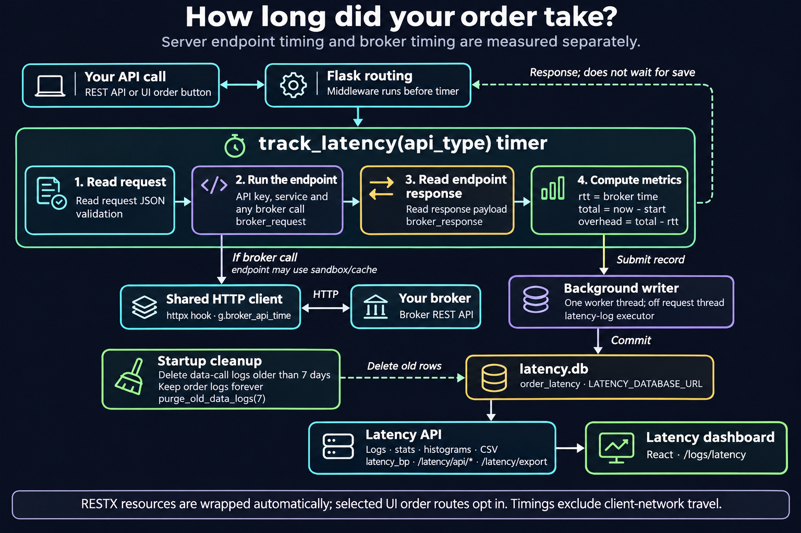

# 25 - Latency Monitor

## Overview

OpenAlgo tracks order execution latency at multiple stages to help identify performance bottlenecks and ensure SLA compliance.

Every `/api/v1` call is timed, not only orders. The monitor reports them one group of endpoints at a time, with orders as the default, because an average across an order and a history download describes neither. See [Endpoint Groups](#endpoint-groups).

Latency records live in their own database, `LATENCY_DATABASE_URL` (default `sqlite:///db/latency.db`), separate from both `openalgo.db` and `logs.db`.

## Architecture Diagram

<figure><figcaption></figcaption></figure>

## Metrics Tracked

### Latency Components

| Metric | Description |
|--------|-------------|
| rtt_ms | Broker API round-trip time |
| validation_latency_ms | Pre-request validation |
| response_latency_ms | Post-response processing |
| overhead_ms | Total OpenAlgo overhead |
| total_latency_ms | End-to-end time |

The column names on `OrderLatency` are `validation_latency_ms` and `response_latency_ms`. The `request_body` and `response_body` columns exist but are always written as `None`: `_log_latency_async()` passes `request_body=None, response_body=None` to save space, so no payloads are stored.

### Database Schema

```
┌───────────────────────────────────────────────────────────────────────────┐
│                            order_latency table                            │
├───────────────────────┬─────────────┬─────────────────────────────────────┤
│ Column                │ Type        │ Description                         │
├───────────────────────┼─────────────┼─────────────────────────────────────┤
│ id                    │ Integer PK  │ Auto-increment                      │
│ timestamp             │ DateTime    │ Log time, server default now()      │
│ order_id              │ String(100) │ Order ID, not null                  │
│ user_id               │ Integer     │ User ID                             │
│ broker                │ String(50)  │ Broker name                         │
│ symbol                │ String(50)  │ Trading symbol                      │
│ order_type            │ String(20)  │ Endpoint tag: PLACE, HISTORY, ...   │
│ rtt_ms                │ Float       │ Broker API round-trip time          │
│ validation_latency_ms │ Float       │ Pre-request processing              │
│ response_latency_ms   │ Float       │ Post-response processing            │
│ overhead_ms           │ Float       │ Total OpenAlgo overhead             │
│ total_latency_ms      │ Float       │ End to end, not null                │
│ request_body          │ JSON        │ Declared but always written as None │
│ response_body         │ JSON        │ Declared but always written as None │
│ status                │ String(20)  │ SUCCESS, FAILED, PARTIAL            │
│ error                 │ String(500) │ Error message if any                │
└───────────────────────┴─────────────┴─────────────────────────────────────┘
```

`order_type` holds the endpoint the call was to (`PLACE`, `HISTORY`, `FUNDS` and so on), not the price type of an order. The column name is from when only orders were recorded.

## Endpoint Groups

`database/latency_groups.py` is the one place that says which tag each endpoint is recorded under and which group it belongs to. The recorder, the statistics, the purge and the page all read it; none keeps a list of its own. The groups follow the sections of the [API reference](../../api-documentation/v1/README.md).

| Group | Endpoints | Kept |
|-------|-----------|------|
| Orders (default) | Place, smart, options, options multi-leg, basket, split, modify, cancel, cancel all, close position, and the three GTT actions | Forever |
| Account and books | Order status, open position, order book, trade book, position book, holdings, funds, margin, GTT order book | 7 days |
| Market data | Quote, multiple quotes, depth, history, ticker | 7 days |
| Options | Option chain, Greeks, batch Greeks, option symbol, synthetic future | 7 days |
| Symbols and settings | Symbol, search, expiry, instruments, intervals, market calendar, analyzer mode, sandbox P&L, chart preferences, ping | 7 days |
| Tools and alerts | Portfolio, SIP and sector analysis, the strategy module, Telegram, WhatsApp, Slack, Discord | 7 days |
| Other | Any record whose tag is in no group. Listed only when there is one. | 7 days |
| All calls | Every record together | As above |

Rules that follow from this:

- **A group's figures come from that group's records only.** Counts, averages and the speed bands cover everything stored for the group; the median and P99 cover the last 30 days.
- **Only orders are rated.** The Excellent, Good, Acceptable and Slow bands (150, 250 and 400 ms) describe an order confirmation, so the page shows them for the orders group and not for the others.
- **The orders group is the keep list.** `ORDER_TAGS` is what `purge_old_data_logs` leaves alone. There is one list, not one per module.
- **A new endpoint has to be placed.** `test/test_latency_groups.py` fails for a registered namespace that has no `Endpoint` in a group, and for a group that names a namespace that does not exist.
- **Old spellings are read as what they are.** Options orders were once stored as `OPTIONSORDER` and `OPTIONSMULTIORDER`; `LEGACY_TAGS` counts those rows as options orders and keeps them.

## Implementation

### Latency Tracker Class

`utils/latency_monitor.LatencyTracker` records named stages rather than fixed marks:

```python
class LatencyTracker:
    def start_stage(self, stage_name): ...
    def end_stage(self): ...
    def get_total_time(self): ...
    def get_rtt(self): ...
    def get_overhead(self): ...
```

`get_rtt()` returns the broker round trip, `get_overhead()` the sum of the non-broker stages, and `get_total_time()` the end-to-end elapsed time. The record itself is written off the request thread by `_log_latency_async()` on a single-worker `ThreadPoolExecutor`, so the SQLite commit never delays the order response.

### Decorator Wiring

`track_latency(api_type)` is not applied by hand to route functions. `init_latency_monitoring(app)` walks the Flask-RESTX namespaces and wraps every resource method through `wrap_resource_methods()`, taking each namespace's tag from `database/latency_groups.py`.

```python
# utils/latency_monitor.py
from database.latency_groups import TAG_FOR_NAMESPACE

for namespace in api.namespaces:
    api_type = TAG_FOR_NAMESPACE.get(namespace.name, namespace.name.upper())
    for resource in namespace.resources:
        wrap_resource_methods(resource.resource, api_type)
```

A namespace placed in no group falls back to its uppercased name and is reported under **Other**; `test/test_latency_groups.py` fails until it is placed.

## Dashboard

### Access
```
/logs/latency
```

### Routes

`latency_bp` is registered with `url_prefix="/latency"`. All routes require a valid session.

| Route | Behavior |
|-------|----------|
| `GET /latency/` | Older server-side dashboard template, still registered |
| `GET /latency/api/logs` | Recent records of one group; `limit` defaults to 100 and is capped at 1,000 |
| `GET /latency/api/stats` | One group's overall stats, per-broker stats and per-endpoint stats, cached for 60 seconds |
| `GET /latency/api/broker/<broker>/stats` | One broker's stats in a group, plus its RTT histogram |
| `GET /latency/export` | Export as CSV: every record as `latency_logs.csv`, or one group as `latency_<group>.csv` |

Each route takes the group in the query string: `/latency/api/stats?group=orders`, `/latency/api/logs?group=market_data`, `/latency/export?group=orders`. The figures and records default to `orders`; the export defaults to everything. A name that is not a group is refused with a 400.

`/latency/api/stats` no longer attaches per-broker histograms: nothing on the page drew them, and building them read every record of every broker on each poll. Only the one-broker route still builds a histogram, with 30 numpy bins over that broker's observed RTT range.

### Dashboard View

```
┌─────────────────────────────────────────────────────────────────────────────┐
│                              Latency Dashboard                              │
│                                                                             │
│  Average Latency: 85ms     P95: 145ms     P99: 195ms     SLA: 98.5%         │
│                                                                             │
│ ┌─────────────────────────────────────────────────────────────────────────┐ │
│ │ Latency Distribution (Last 24h)                                         │ │
│ │                                                                         │ │
│ │  < 50ms  ████████████████████████████  45%                              │ │
│ │  50-100ms  ██████████████████  35%                                      │ │
│ │  100-150ms  ████████  15%                                               │ │
│ │  150-200ms  ██  4%                                                      │ │
│ │  > 200ms  █  1%                                                         │ │
│ └─────────────────────────────────────────────────────────────────────────┘ │
│                                                                             │
│ ┌─────────────────────────────────────────────────────────────────────────┐ │
│ │ Recent Orders                                                           │ │
│ │                                                                         │ │
│ │ Time      │ Symbol   │ Broker   │ RTT    │ Total  │ Status              │ │
│ ├───────────┼──────────┼──────────┼────────┼────────┼─────────────────────┤ │
│ │ 09:30:15  │ SBIN     │ zerodha  │ 65ms   │ 78ms   │ SUCCESS             │ │
│ │ 09:30:20  │ INFY     │ dhan     │ 45ms   │ 55ms   │ SUCCESS             │ │
│ │ 09:31:05  │ RELIANCE │ angel    │ 180ms  │ 195ms  │ SUCCESS             │ │
│ │ 09:32:10  │ TCS      │ zerodha  │ 350ms  │ 380ms  │ TIMEOUT             │ │
│ └─────────────────────────────────────────────────────────────────────────┘ │
└─────────────────────────────────────────────────────────────────────────────┘
```

## SLA Targets

### Performance Thresholds

`get_latency_stats()` reports two independent things: the share of orders under three hard-coded millisecond thresholds, and four percentiles of `total_latency_ms`. The thresholds are not configurable and there is no 175 ms bucket.

| Field | Meaning |
|-------|---------|
| sla_100ms | Percent of orders under 100 ms end to end |
| sla_150ms | Percent of orders under 150 ms end to end |
| sla_200ms | Percent of orders under 200 ms end to end |
| p50_total, p90_total, p95_total, p99_total | Percentiles of `total_latency_ms` |

### SLA Calculation

```python
# database/latency_db.py, condensed
overall = latency_session.query(
    func.count(OrderLatency.id).label("total"),
    func.sum(case((OrderLatency.total_latency_ms < 200, 1), else_=0)).label("under_200"),
).first()

sla_200ms = (overall.under_200 / overall.total * 100) if overall.total else 0
```

The whole statistics block is computed in a handful of aggregate queries and cached for 60 seconds (`_stats_cache`, a `LockedTTLCache` of size 1). Percentiles are computed only over the last `PERCENTILE_WINDOW_DAYS` (30) days so the fetch cannot grow without bound.

## Broker Comparison

### Per-Broker Stats

```
┌─────────────────────────────────────────────────────────────────┐
│                    Broker Latency Comparison                    │
│                                                                 │
│  Broker      │ Avg RTT  │ P95 RTT  │ Success Rate               │
│  ────────────┼──────────┼──────────┼─────────────────────────   │
│  zerodha     │ 65ms     │ 120ms    │ 99.8%                      │
│  dhan        │ 45ms     │ 95ms     │ 99.9%                      │
│  angel       │ 85ms     │ 160ms    │ 99.5%                      │
│  shoonya     │ 75ms     │ 140ms    │ 99.7%                      │
│  firstock    │ 55ms     │ 110ms    │ 99.6%                      │
└─────────────────────────────────────────────────────────────────┘
```

## Retention

`init_latency_monitoring(app)` calls `purge_old_data_logs(days=7)` once at startup.

Order-execution records are kept forever. Everything else, meaning data and account queries, is deleted after seven days. The keep-forever set is the orders group, `ORDER_TAGS` in `database/latency_groups.py`, which both `utils/latency_monitor.KEEP_FOREVER_TYPES` and `database/latency_db.purge_old_data_logs` read, so there is one list to change. Before 2.0.3.4 the set was written out in two places and the tagging table misspelled the options orders, so options and options multi-leg orders were purged after a week; records stored under those old spellings (`LEGACY_TAGS`) are now counted as orders and kept.

## Alerting

There is no latency alerting. Nothing in the codebase raises a notification on a slow order or a broker timeout. The monitor records, aggregates, and displays; acting on a threshold is left to the operator watching the dashboard.

## HTTP Client Integration

### Connection Timing

```python
# utils/httpx_client.py, registered as httpx event_hooks
def log_request(request):
    request.extensions["start_time"] = time.time()


def log_response(response):
    start_time = response.request.extensions.get("start_time")
    if start_time:
        duration_ms = (time.time() - start_time) * 1000
        ...


client = httpx.Client(
    event_hooks={"request": [log_request], "response": [log_response]},
    ...
)
```

## Analytics Queries

### Common Queries

```python
# Average latency by broker
SELECT broker, AVG(rtt_ms) as avg_rtt
FROM order_latency
WHERE timestamp > NOW() - INTERVAL '24 hours'
GROUP BY broker

# SLA compliance by hour
SELECT
    DATE_TRUNC('hour', timestamp) as hour,
    COUNT(*) as total,
    SUM(CASE WHEN total_latency_ms < 200 THEN 1 ELSE 0 END) as within_sla
FROM order_latency
GROUP BY hour

# Slowest requests
SELECT *
FROM order_latency
ORDER BY total_latency_ms DESC
LIMIT 10
```

## Key Files Reference

| File | Purpose |
|------|---------|
| `utils/latency_monitor.py` | Tracking utilities |
| `database/latency_db.py` | Latency model and per-group statistics |
| `database/latency_groups.py` | Endpoint tags and groups (the single definition) |
| `blueprints/latency.py` | Dashboard and export routes |
| `utils/httpx_client.py` | HTTP timing hooks |
| `frontend/src/pages/monitoring/LatencyDashboard.tsx` | React dashboard |
| `frontend/src/api/latency.ts` | The dashboard's types and requests |
| `test/test_latency_groups.py` | What belongs to which group, and that figures are per group |
