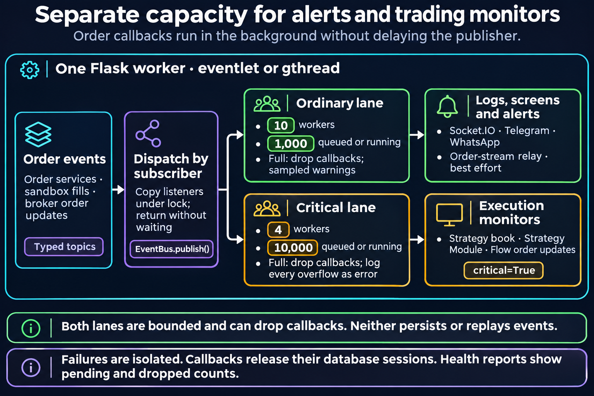

# 53 - Event Bus

## Scope

`utils/event_bus.py` is a lightweight, **per-process** topic bus for asynchronous order side effects. It is not the cross-process market-data bus; ZeroMQ owns that job.

The single production Flask worker owns the singleton subscriber registry. Ordinary callbacks use a shared 10-worker executor capped at 1,000 queued-or-running callbacks. `critical=True` subscribers use a separate four-worker executor capped at 10,000, so slow alert delivery cannot consume the strategy/order-update lane.

At capacity, ordinary callbacks are dropped with sampled warnings; each critical overflow is logged as an error. Both lanes are bounded and neither is durable. `bus.stats()` reports pending, capacity and dropped counters for each lane. Publishers do not wait for subscribers to finish.

## Flow

<figure><figcaption></figcaption></figure>

Callback lists are copied under a lock. Subscriber failures are isolated, and every callback releases the scoped SQLAlchemy sessions it opened before its pool thread serves another event.

## Topics

| Topic | Event |
|---|---|
| `order.placed` | Successful single order |
| `order.failed` | Failed order |
| `order.no_action` | Smart order already at target |
| `order.modified`, `order.modify_failed` | Modify result |
| `order.cancelled`, `order.cancel_failed` | Cancel result |
| `orders.all_cancelled` | Cancel-all summary |
| `order.update` | Async broker postback / order-WS fill or rejection, and sandbox engine transitions |
| `gtt.placed`, `gtt.failed` | GTT placement result |
| `gtt.modified`, `gtt.modify_failed` | GTT modify result |
| `gtt.cancelled`, `gtt.cancel_failed` | GTT cancel result |
| `gtt.triggered`, `gtt.expired` | GTT lifecycle transitions |
| `position.closed` | Close-position summary |
| `basket.completed` | Basket summary |
| `split.completed` | Split summary |
| `options.completed` | Options-order summary |
| `multiorder.completed` | Multi-leg summary |
| `analyzer.error` | Analyzer validation/runtime error |
| `sandbox.order_filled` | Engine-driven fill refresh |
| `sandbox.auto_squareoff` | Engine-driven square-off refresh |
| `sandbox.t1_settlement` | Engine-driven settlement refresh |

Batch services suppress child events and publish one summary, preventing duplicate logs/chat alerts.

## Subscribers

`subscribers/__init__.py:register_all()` wires log, Socket.IO, Telegram, and WhatsApp callbacks for the order and GTT topics. Sandbox engine-internal topics go only to Socket.IO because they are UI refresh signals rather than user API calls; they are not duplicated into analyzer logs or chat alerts. `order.update` is engine-driven and broker-driven for the same reason: it goes to Socket.IO and to `wsproxy_subscriber`, which republishes it on the ZeroMQ bus so the WebSocket proxy can relay it to clients that sent `subscribe_orders`.

`subscribers/strategy_book_subscriber.register(bus)` is wired separately, from the database-initialization thread in `app.py` rather than from `register_all()`, because it must be listening before the first order is accepted. It subscribes to `order.placed`, `order.update`, and the four batch-completion topics on the critical lane. Strategy Module order updates and Flow order-update monitors also register critical callbacks.

Telegram/WhatsApp subscribers skip failure and analyzer-error chat notifications. The log and Socket.IO consumers still record/emit the applicable state.

## Event Data

Order events carry mode, API type, strategy, request/response data, and fields needed for notification formatting. API keys may be passed in memory for username resolution but must be stripped from persisted request logs. Do not add broker tokens or other decrypted credentials to an event.

## Why Per-Process

The bus decouples side effects on a single request path with minimal dependencies. It makes no durability or cross-worker delivery guarantee. Features that require cross-process delivery, replay, or durable queues need a different transport; do not infer those properties from this bus.

## Adding An Event Or Subscriber

1. Add a typed event under `events/` with a stable topic.
2. Publish once at the service boundary, after the outcome is known.
3. Add callbacks and registrations in `subscribers/__init__.py`.
4. Keep callbacks idempotent where duplicate upstream requests are possible.
5. Test publisher response independence and subscriber failure isolation.

## Key Files

| File | Purpose |
|---|---|
| `utils/event_bus.py` | Bus and executor singleton |
| `events/` | Typed payloads |
| `subscribers/__init__.py` | Registration |
| `subscribers/log_subscriber.py` | Database logging |
| `subscribers/socketio_subscriber.py` | Browser refresh/events |
| `subscribers/telegram_subscriber.py` | Telegram alerts |
| `subscribers/whatsapp_subscriber.py` | WhatsApp alerts |
| `subscribers/wsproxy_subscriber.py` | ZeroMQ relay of order updates to the proxy |
| `subscribers/strategy_book_subscriber.py` | Per-strategy position book |
