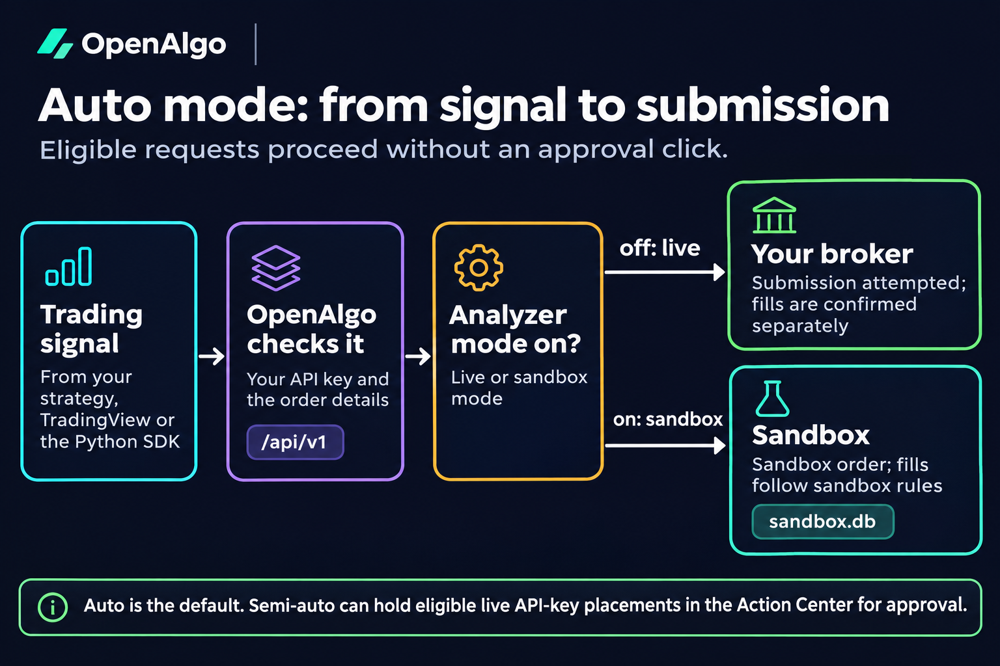
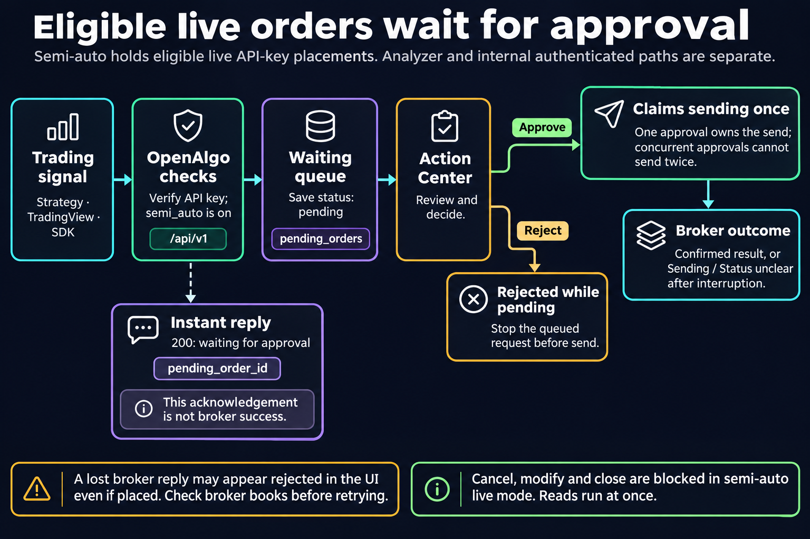

# Action Center

Action Center is the approval queue for eligible **live** placement requests in Semi-Auto order mode. It lets you review a signal's instrument and size before sending it to the broker.

<figure><figcaption></figcaption></figure>

## Auto and Semi-Auto

**Auto** submits supported requests immediately through the current execution path. A submitted order is not necessarily filled.

<figure><figcaption></figcaption></figure>

**Semi-Auto** queues eligible live placements. Analyzer branches can execute directly in the sandbox before live-order approval routing, so check the response's mode.

<figure><figcaption></figcaption></figure>

Live/Analyze is the execution destination. Auto/Semi-Auto is the approval policy. They are separate settings and both apply across the single-user instance.

## Enable and Submit

1. Open the profile menu's **API Key** page (`/apikey`).
2. In **Order Execution Mode**, choose **Semi-Auto**.
3. Send the intended placement through your integration.
4. Open **Action Center** from the profile menu or `/action-center`.

Your SDK call keeps the normal placement contract:

```python
response = client.placeorder(
    strategy='ReviewExample',
    symbol='SBIN',
    exchange='NSE',
    action='BUY',
    quantity=1,
    price_type='MARKET',
    product='MIS',
)
print(response)
```

A queued request returns an approval-record ID:

```json
{
  "status": "success",
  "message": "Order queued for approval in Action Center",
  "mode": "semi_auto",
  "pending_order_id": 123
}
```

`pending_order_id` is not a broker order ID or a fill. If the sender submits the same signal twice, it can create two separate approval records.

## Review and Act

Use **Pending**, **Approved**, **Rejected** or **All Orders**. Expand a row to inspect its original data and every basket leg. Check symbol, exchange, product, side, quantity, prices and whether the signal is still valid.

| Control | Effect |
|---|---|
| Approve | Claims a still-pending request and sends it through its order service |
| Reject | Rejects a still-pending request without sending it |
| Approve All | Approves the pending queue in a batch; review all rows first |
| Refresh | Rereads the list and statistics |
| Delete | Removes an approved/rejected record after confirmation; it does not cancel orders or close positions |

Pending rows must be approved or rejected before deletion. The current page has no Modify or Save & Approve form. Reject a wrong pending request and correct its source after checking it was never sent.

Statistics show pending approvals, buy orders, sell orders, approved orders and rejected orders. Socket.IO updates the list when requests arrive or decisions change; a manual refresh is available.

## Sending and Status Unclear

OpenAlgo claims each approved record for sending at most once. Two tabs approving the same record do not intentionally send it twice. This protection does not deduplicate separate requests from your integration.

An approved row whose send began without a recorded broker answer shows **Sending** for the first two minutes, then **Status unclear**. A split or basket can take longer than two minutes, so age does not prove that sending stopped. An interruption can also leave an unknown result.

When the outcome is unclear:

1. Check the broker's own order book, trades and positions for every leg.
2. Refresh Action Center and inspect the application logs.
3. Reconcile the actual outcome before sending any replacement. Do not place the order again while its status is unclear.


A lost broker response still requires reconciliation even if the recorded broker status says **rejected** or the approval response says execution failed. Some execution-error paths record a rejection after an ambiguous upstream response. That label alone does not prove the broker received nothing.


If a request is proven not sent and returned to Pending, read the refusal and correct its cause before approving again. Approved means you authorized a send, not that every order filled: limit orders can remain open and baskets can have partial outcomes.

## Which Operations Are Queued?

The approval executor dispatches regular, smart, basket, split, options, multi-options and place-GTT requests. GTT/live availability still depends on the broker.

Read-only account and market-data operations are not queued. Close, cancel, cancel-all, modify, modify-GTT and cancel-GTT live service paths are refused in Semi-Auto rather than becoming pending approvals. Check the relevant [API reference](../api-documentation/v1/README.md) before relying on an automated exit or cancellation.

Returning to Auto affects new requests; it does not make old pending approvals into fills. Keep Action Center visible while depending on manual review. Use [Analyzer mode](api-analyzer.md) for rehearsal, and preserve the records of any outcome you are still investigating.
