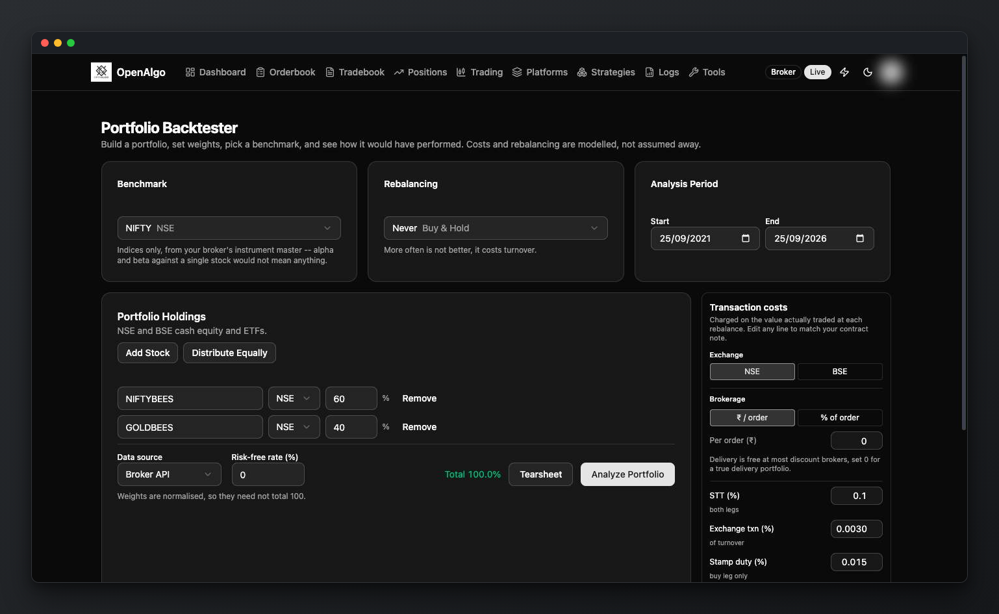
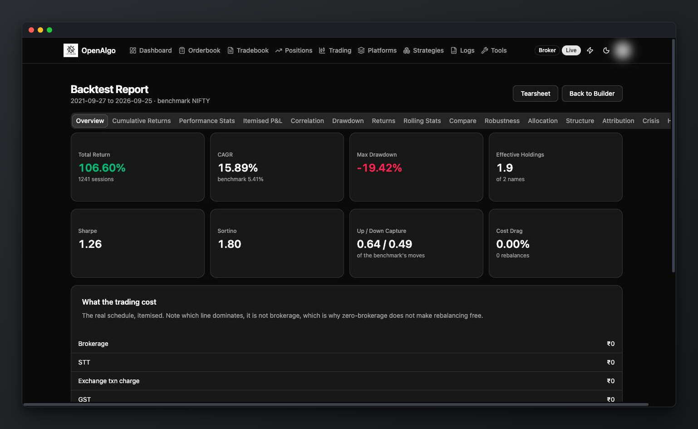

# Portfolio, SIP Backtesting and Holdings Analysis

OpenAlgo provides authenticated, read-only investment workflows:

* **Portfolio Backtester** simulates a target allocation over a historical window.
* **SIP Backtester** simulates periodic investment in one NSE/BSE instrument.
* **Portfolio Analyzer** reads the holdings currently reported by the connected broker, weights them by current market value, and tests how that allocation would have behaved over a selected lookback.

These workflows do not place, modify or cancel orders.

## Before You Start

* Create an OpenAlgo API key.
* For **Historify**, ingest daily history for every holding/instrument and the selected benchmark. The Backtester and SIP input forms initially select Broker API; the Analyzer initially selects Historify.
* For the **Broker API** source, log in to the broker and confirm that its history API covers the required symbols and dates.
* The engine supports long-only NSE/BSE cash equities and ETFs. It does not model derivatives, short positions, or a separate cash sleeve.

## Backtest a Portfolio

1. Open `/portfolio-backtester`.
2. Add NSE/BSE holdings and assign their percentage weights. Editing a weight rescales the other rows; check the final allocation before running. Programmatic clients can supply up to 50 unique holdings and the API normalizes their positive-weight ratios.
3. Choose the date range and optional index benchmark.
4. Choose a history source:
   * `db` reads the local Historify store in one multi-symbol query.
   * `api` calls the active broker's history service sequentially.
5. Select buy-and-hold (`never`), monthly, quarterly or yearly rebalancing.
6. Configure the risk-free rate and the displayed delivery-cost controls. The Portfolio API supports additional simulation settings; use its contract rather than assuming every parameter has a UI control.
7. Run the backtest. The results page uses one internally consistent result object; changing tabs does not rerun the simulation.

<figure><figcaption></figcaption></figure>

## Understand the Results

The analysis can include:

* portfolio and benchmark equity curves;
* returns, volatility, drawdown, Sharpe/Sortino, capture, and rolling statistics;
* holding contributions and trailing returns;
* correlation, effective-holdings concentration, co-movement groups, and allocation drift;
* realized trading costs, turnover, and rebalancing dates;
* walk-forward windows, Monte Carlo paths, crisis periods, attribution, and seasonality;
* a portfolio-health grade whose inputs, formulas, and pillar weights are returned with the score.

Use **Download tearsheet** to export the same model as a self-contained `portfolio-tearsheet.html` file.

<figure><figcaption></figcaption></figure>

## Backtest a SIP

1. Open `/sip-backtester` from [Tools](../analytics-and-options-tools.md).
2. Select one NSE/BSE instrument, contribution amount and weekly, fortnightly, monthly or quarterly frequency.
3. Set dates, optional annual step-up and the contribution day where the frequency uses one.
4. Choose Broker API or Historify, benchmark and cost assumptions, then run.
5. Inspect XIRR, rupee-cost averaging, start-date sensitivity and the lumpsum comparison.

This is a historical simulation. It does not create or schedule a real investment plan. See the [SIP Backtest API](../api-documentation/v1/utilities-api/sip-backtest.md) for automation.

## Analyze Current Holdings

1. Log in to the broker.
2. Open `/portfolio-analyzer`.
3. Choose a lookback and history source. The current Analyzer UI uses NIFTY as its benchmark; the API exposes additional request settings.
4. OpenAlgo loads usable broker holdings, calculates market-value weights, and runs the same analytics engine.

Unsupported exchanges remain visible in the holdings summary and are listed as skipped. This is a current-allocation historical scenario, not an account-performance report: holdings data does not reveal when each lot was bought or the investor's cash flows.

## Limits

* Results use close-to-close price returns. Dividends are absent unless the selected history source embeds an adjusted series.
* Missing holding history fails the run instead of silently dropping the asset.
* Missing benchmark history degrades benchmark-relative sections but does not invalidate the portfolio calculation.
* Results depend on history quality, the chosen allocation, and cost assumptions. They are not a forecast or investment advice.

See the [Portfolio API](../api-documentation/v1/portfolio.md) for automation and [Portfolio Analytics Architecture](../developers/design-documentation/55-portfolio-analytics.md) for implementation boundaries.
