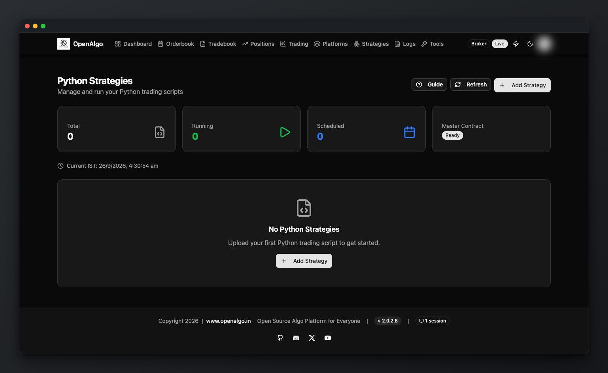
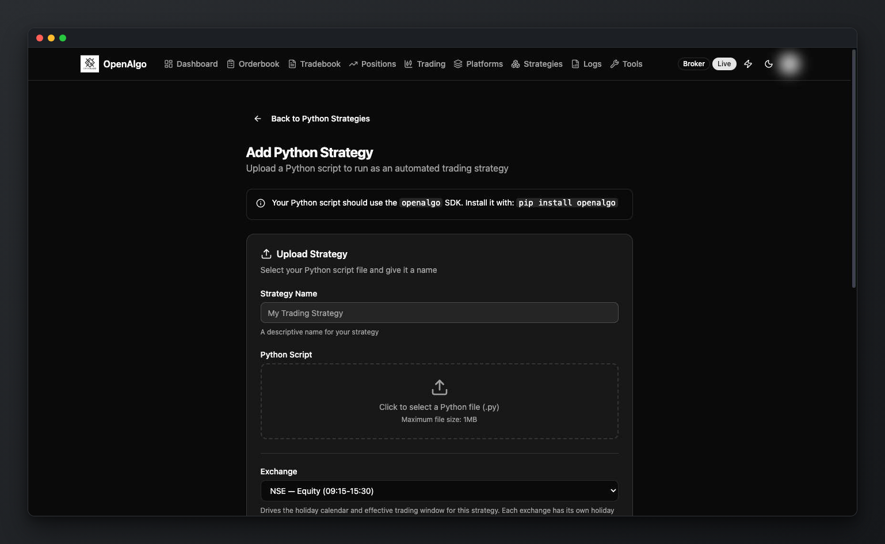

# Python Strategy Hosting

***

## Hosting Python Strategies in OpenAlgo

OpenAlgo hosts trusted Python trading strategies as separate subprocesses. Each run has its own process and log file, but lifecycle and scheduling state are still owned by the single OpenAlgo web worker.



### 1. Accessing the Python Strategy Manager

To begin, log into your OpenAlgo dashboard:

* Click on your **Profile** icon in the top right corner.
* Select **Python Strategies** from the dropdown menu.
* This dashboard provides an overview of your total, running, and scheduled strategies.

<figure><figcaption></figcaption></figure>

### 2. Adding a New Strategy

Click the **Add Strategy** button to open the configuration interface.

<figure><figcaption></figcaption></figure>

#### Uploading the Script

* **Strategy Name:** Enter a unique descriptive name for your strategy.
* **Python Script:** Upload your `.py` file. OpenAlgo supports standard Python libraries and the OpenAlgo SDK.

#### Configuration & Scheduling

* **Exchange:** Choose from the connected broker's supported exchanges. The initial choice follows its default. This controls the host's holiday calendar and session window; your script still needs the correct exchange in each API request.
* **Schedule:** Scheduling is required and all times are IST. Securities exchanges use the calendar database, including holidays, partial sessions and special sessions. A process stops at the earlier of your stop time or that exchange's session close.
* **Crypto:** For `CRYPTO`, turn on **Run 24/7** to run every day with no stop time and no Indian-exchange holiday checks. Turn it off for particular days and hours; timed crypto windows may cross midnight. Identical start/stop times are refused, so use Run 24/7 when you intend no stop.

### 3. Monitoring & Management

Once a strategy is added, it will appear on your Python Strategies page.

* **Start / Stop / Cancel:** Start runs the saved file immediately within its eligible window, or schedules it for later. Read the returned message. Stop ends a process; Cancel cancels a scheduled auto-start. Neither is an instruction to close broker positions.
* **View Logs:** Click "View Logs" to see real-time output. This section tracks data fetching, signal generation, and order execution. You can copy or download these logs for debugging.
* **Edit Code:** Running strategies open read-only; stop before editing. Save or discard unsaved edits before Start or View Logs. `Ctrl+S`/`Cmd+S` saves; `F11` opens fullscreen and `Esc` leaves it. Start/Stop/Cancel and View Logs remain available in fullscreen.
* **Schedule:** Edit it while stopped. The card displays **24/7** for a continuous crypto schedule; the schedule cannot simply be disabled.

### 4. Execution Modes

OpenAlgo features a toggle to prevent accidental trades during development:

* **Analyzer Mode:** Use this for testing purposes. Supported orders sent through OpenAlgo use the sandbox instead of the live broker. Python code is trusted code on your server; analyzer mode does not prevent arbitrary code from calling a broker directly.
* **Live Mode:** Once your strategy is verified, switch to Live Mode to enable actual order placement.

### 5. Technical Environment Variables

When your script runs within OpenAlgo, several environment variables are automatically injected. You should use these instead of hardcoding sensitive data:

| Variable | Description |
|---|---|
| `OPENALGO_API_KEY` | Decrypted application API key, when one is configured. |
| `STRATEGY_ID` | Unique identifier for the strategy. |
| `STRATEGY_NAME` | Strategy display name. |
| `OPENALGO_HOST` | Internal host URL for REST requests. |
| `OPENALGO_STRATEGY_EXCHANGE` | Exchange selected in the strategy schedule. |

Do not use the obsolete `OPENALGO_APIKEY` spelling. Build the WebSocket URL from the deployment configuration or your own strategy setting; `OPENALGO_WS_URL` is not one of the values injected by the current process launcher.

### 6. Verifying Orders

After a trade is triggered by your Python strategy, you can verify it in two places:

1. **Strategy Logs:** Shows the logic and parameters that triggered the trade.
2. **Order Book:** Shows the status (Complete, Rejected, etc.) and details (Price, Quantity, Product Type) of the order sent to the broker.

***

#### Best Practices

* Always test new strategies in **Analyzer Mode** for at least one full trading session.
* Use the **Python Strategy Guide** link within the app for updated code snippets and recommended patterns.
* Ensure your OpenAlgo instance has a stable internet connection if running on a local machine to prevent WebSocket disconnections.
* Run only code you trust. Hosted scripts execute as the OpenAlgo operating-system user and inherit the application environment.
* Keep one Gunicorn web worker. Strategy ownership, schedules, and live process state are process-local.
* On a gthread installation, each open Python Strategies page keeps one live status connection, which holds one of the instance's 64 request threads. At most eight windows get live status at once; the next still works, without live updates.
* The host restores schedules and reconciles saved running strategies after restart. This is process recovery, not proof that your script safely reconstructs positions; reconcile broker orders and positions before new entries. After an abnormal stop, verify actual process and account state.

The production default remains Gunicorn with one eventlet worker. [gthread](../getting-started/gthread-migration.md) is available on main as an opt-in worker with 64 request threads; `uv run app.py` uses the development server and ignores that worker setting.

## Before a Live Run

Verify the broker, **Live/Analyze** badge and saved schedule before starting. Logging out or closing the browser does not stop hosted strategies. [Broker switching](../connect-brokers/broker-configuration.md#switching-brokers) is refused while relevant live automation still runs.

A successful order response is an acceptance, not a fill. If a response is lost or times out, reconcile order book, trades and positions before sending a replacement. In Semi-Auto, a queued request still needs approval in [Action Center](action-center.md). Do not build an automatic order retry around an unclear response.
