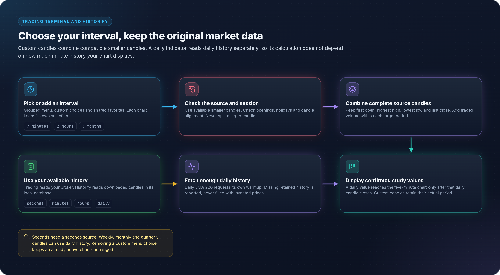

# Chart Trading Terminal

The `/trading` route is OpenAlgo's multi-chart trading workspace. It combines historical and live market data, chart analysis, drawings, market depth, and order entry in one React interface.

<figure><figcaption></figcaption></figure>

## Layouts and State

Seven persisted layouts are available:

* one chart;
* two charts side by side;
* two charts stacked;
* a three-chart `1 + 2` layout with one large pane;
* a `2×2` four-chart grid;
* a six-chart `3×2` grid;
* an eight-chart `4×2` grid.

Each pane retains its own symbol and chart state. Layout choice and supported chart preferences persist in the browser or application preference store so returning to the terminal restores the workspace.

## Charts and History

The terminal supports candles, bars, line and area variants, Heikin Ashi, Renko, Range Bars, Line Break, Point & Figure and Kagi. Scrolling to the left edge requests older history so analysis is not limited to the initial window.

**Brick and line chart types.** Heikin Ashi, Renko, Range Bars, Line Break, Point & Figure and Kagi are formed by the chart from the time bars, so a brick appears the moment the tick that completes it arrives. The brick, range or reversal size starts at about 0.15 percent of the last close; change it, and the other options of the chart type, on the Price tab of the chart settings. A size you set is kept for that instrument and chart type. The volume under a brick or a Kagi line is the traded volume of the bars that formed it.

**Bar replay** steps through the time bars on every chart type, so on a brick chart the bricks form as each bar is revealed. Trading is refused while a chart replays.

**Indicators.** 112 built-in studies, and your own from `strategies/indicators/`. Several instances can be added and configured per pane. On a brick or line chart type, a study's **Compute on** row chooses between the chart's bricks and the underlying time bars. 29 built-in studies have a **Timeframe** row. The terminal requests their higher-timeframe history separately, so a daily EMA with length 200 can appear on a five-minute chart without loading years of minute candles. Values appear only after their source period closes. The broker must retain enough source history; an unavailable request reports its status rather than inventing prices. OpenScript studies and strategies are written, backtested and deployed from the Scripts panel; the language is documented at [openalgo.in/script](https://openalgo.in/script).

### Custom intervals

Open the interval menu and choose **Add custom interval**. Choose a unit and a positive whole number, for example 7 minutes or 2 hours. The menu groups choices by unit. Favorite choices stay in the toolbar and are shared with Historify; selecting an interval changes the active pane. Remove a custom choice from its row. Removing it from the menu does not change a chart already using it.

The terminal combines smaller candles supplied by your broker. One-minute candles can form seven-minute candles; compatible hourly candles can form two-hour candles; daily candles can form weeks, months, quarters and years. Seconds require a seconds source. A larger candle cannot supply missing smaller candles. Session openings, holidays and source alignment determine which choices are available.

<figure><figcaption></figcaption></figure>

Replay never requests later confirmed values from a live-only history provider. Independent studies need a historical snapshot contract to run in replay.

Volume and grid display can be adjusted independently from the primary price scale.

## Drawing Tools

One drawing rail controls the active pane and includes line, channel, Fibonacci/Gann, shape, cycle, forecast, measurement, text and volume tools (Anchored VWAP and Fixed Range Volume Profile). Drawings support styling, locking, magnet mode, undo/redo, and per-pane persistence.

The shared rail deliberately targets only the active pane. Confirm the highlighted pane before adding, editing, or removing a drawing in a multi-chart layout.

## Symbols, Market Data, and Orders

Symbol search is ranked and debounced and can be opened independently for every pane. The terminal receives live ticks from OpenAlgo's raw WebSocket proxy, with REST quote fallback where required. The same market-data manager is shared across the page rather than opening one Gunicorn request thread per chart.

The order dialog supports inline order entry and market-depth review. Account-level order updates arrive through the order-update stream when the active broker provides a push adapter; Groww uses the server's explicit orderbook-polling fallback.

## Operational Boundaries

* Historical range, live fields, depth levels, and order-update latency depend on the active broker and account entitlement.
* Market data uses the raw WebSocket proxy on port `8765` (normally exposed as `/ws` behind the production reverse proxy); it is separate from Flask-SocketIO application events.
* A displayed quote or analytical drawing is not a guarantee of execution price.
* Test order entry in Analyzer mode before using the terminal with live capital.

See [WebSocket API](../api-documentation/v1/websockets.md) for the underlying market-data and order-update protocol.
