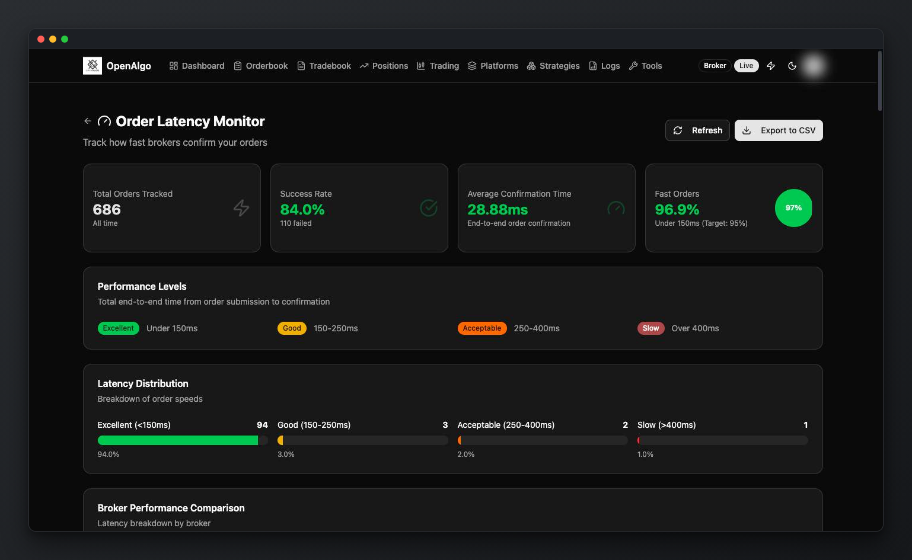

# Traffic and Latency Monitoring

OpenAlgo provides separate views for HTTP traffic metadata and measured API/order latency.

### Traffic Monitor

Open **Logs > Traffic** or visit `/logs/traffic`.

The traffic table stores:

* timestamp;
* client IP;
* HTTP method and path;
* response status;
* middleware duration;
* request host;
* an unhandled error field, when present.

It does **not** store request bodies, response bodies, headers, user agents, or a processing timeline. This avoids persisting API keys and order payloads in the traffic table.

Summary panels show total requests, errors, average duration, and selected endpoint statistics. Filters can limit the view to all traffic or `/api/v1` traffic and to all, successful, or error responses. CSV export contains the same stored metadata.

Traffic rows live in `logs.db`. `TRAFFIC_LOG_RETENTION_DAYS` defaults to 30 days in `.sample.env`, and expired rows are purged when logging initializes.

### Latency Monitor

Open **Logs > Latency** (`/logs/latency`) to review timing records produced by instrumented OpenAlgo operations. The view is useful for comparing observed request durations and identifying changes on the actual deployment.

<figure><figcaption></figcaption></figure>

Latency depends on host load, network distance, broker response time, market conditions, connection reuse, and the operation being measured. The monitor reports observations; it does not guarantee an execution time or isolate exchange latency from every other component.

The page refreshes every 30 seconds and offers Refresh and Export to CSV; the export holds the group that is on screen. Per-order details distinguish broker API duration from application validation/response overhead. Broker API duration combines network and broker processing; it does not isolate exchange-fill latency.

#### Choose a group

Every call to the OpenAlgo API is timed, not only orders. The buttons at the top pick which calls the page describes, and each shows how many calls it holds. The page opens on **Orders**.

| Group | What it covers | Kept for |
| --- | --- | --- |
| Orders | Placing, changing and cancelling orders, closing positions and GTT orders | All time |
| Account and books | Order status, positions, holdings, funds, margin, and the order, trade and GTT books | 7 days |
| Market data | Quotes, depth and price history | 7 days |
| Options | Option chain, Greeks and option symbol lookups | 7 days |
| Symbols and settings | Symbol search, expiry dates, the market calendar and settings, answered from OpenAlgo's own data | 7 days |
| Tools and alerts | Portfolio, SIP and sector analysis, the strategy module and alert messages | 7 days |
| All calls | Everything together | As above |

Every figure on the page is for the chosen group only. A chart or a scanner makes hundreds of history calls for each order, so one average across both would describe neither. Read **Orders** for order speed; **All calls** is there for the total, not for a figure to act on.

The **By Endpoint** table lists each endpoint of the group on its own: how many calls, how many failed, the average, the median (P50) and the slowest 1% (P99), which cover the last 30 days. The Excellent, Good, Acceptable and Slow labels (under 150, 250 and 400 ms) and the share under 150 ms are shown for **Orders** only: they describe an order confirmation, and a history download that takes a second is not a slow order.

Before 2.0.3.4 the page put every call into one set of figures and called them orders, so its numbers under **Orders** now read differently, usually with a lower count.

### Security Boundary

Both dashboards require an authenticated application session. Proxy-derived client IPs are trusted only when `TRUST_PROXY_HEADERS` is enabled; use that setting only behind a controlled reverse proxy.
