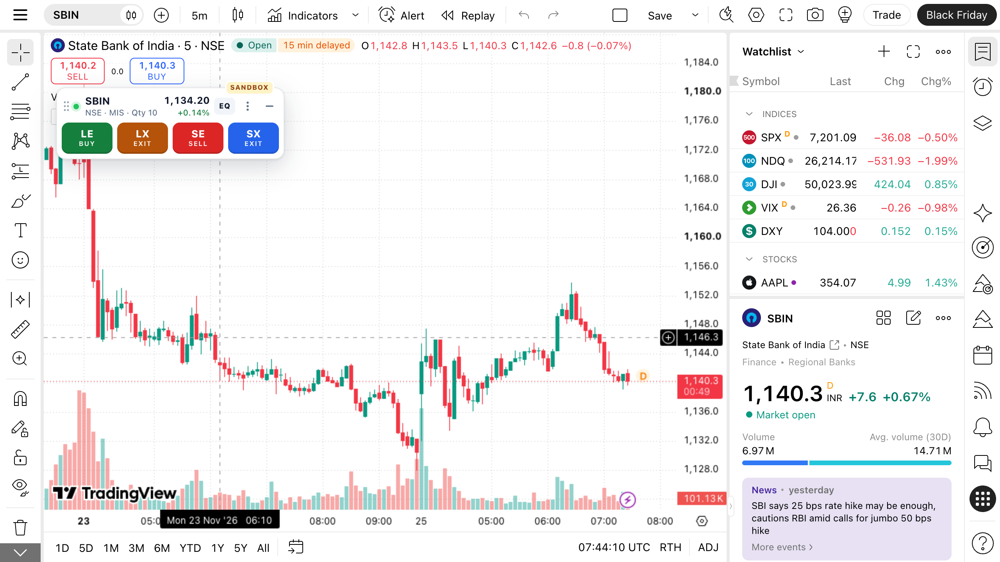
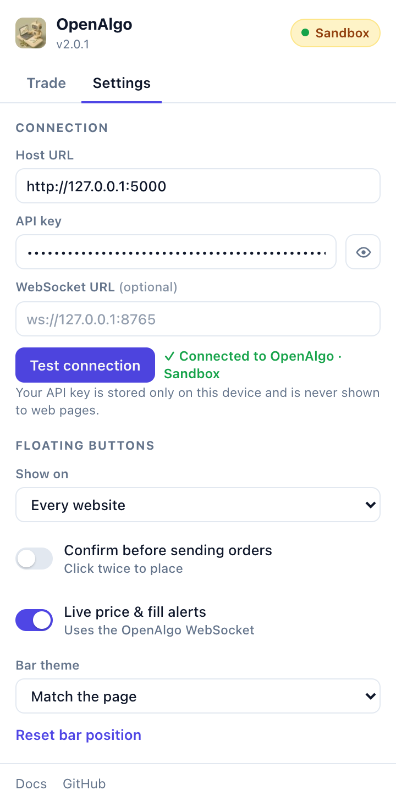
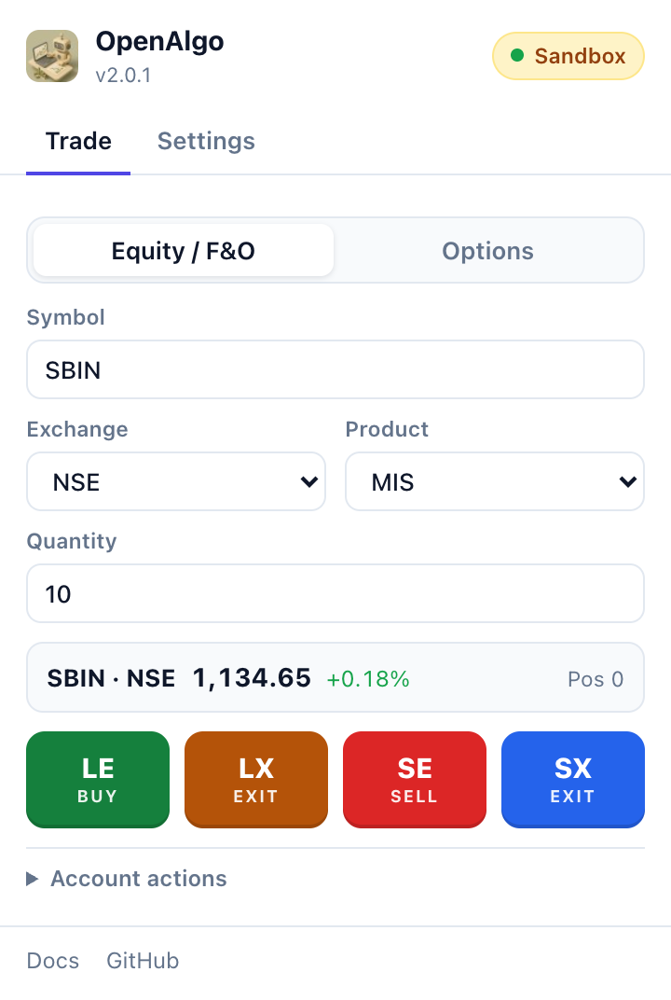
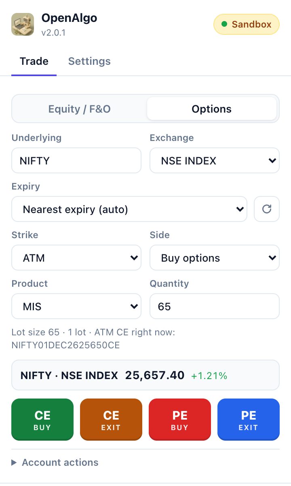
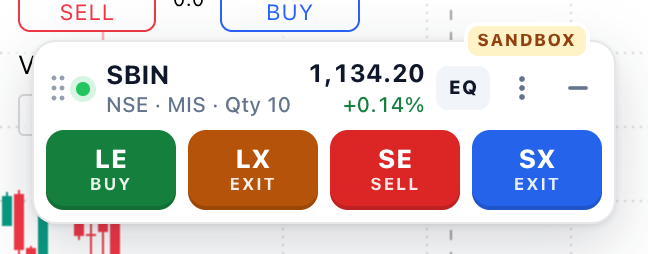
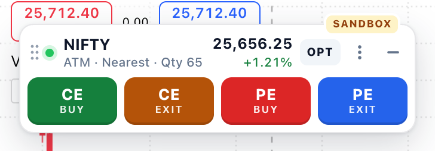

# Chrome Extension

The OpenAlgo Chrome Extension puts one-click trading buttons on any website: TradingView, Chartink, a broker terminal, a news page. Every click goes to your own OpenAlgo server, so orders follow the same broker connection, sandbox (analyzer) mode and logs as everything else in OpenAlgo.

<figure><figcaption>
The floating bar on a TradingView chart
</figcaption></figure>

### What's new in version 2.0

* **Works on every website.** Version 1.0 showed `API Error: Failed to fetch` everywhere except the OpenAlgo dashboard. Version 2.0 sends orders from the extension itself, so the website you are on no longer matters.
* **Options entry and exit.** Buy or sell calls and puts at ATM, ITM1 to ITM10 or OTM1 to OTM10 with one click. The nearest expiry can be picked automatically. Exit closes exactly the contract you opened, even after the market has moved and ATM is a different strike.
* **Live prices and fill alerts.** Over the OpenAlgo WebSocket, the bar shows the live price and day change, and tells you when your order fills or is rejected.
* **Safer.** Your API key never reaches the web page, and a website cannot click the buttons for you or trick you into clicking them. See [Security and privacy](#security-and-privacy).
* **New design.** A clearer bar that shows what it will trade, follows light and dark pages, can be minimised, and can be limited to the sites you choose. The toolbar popup is now a full trading and settings panel.

### Download



Download the latest `openalgo-chrome-v<version>.zip` (currently v2.0.1) from the release page and unzip it.

### Requirements

* **OpenAlgo server** running and reachable (locally or on your own domain).
* **OpenAlgo API key** (OpenAlgo, then API Key).
* **Chrome 116 or later**, or another Chromium browser such as Edge or Brave.
* For live prices and fill alerts: the OpenAlgo WebSocket server (it starts with OpenAlgo; port 8765 locally).

### Installation

1. Open `chrome://extensions/` in Chrome.
2. Turn on **Developer mode** (top right).
3. Click **Load unpacked** and select the unzipped folder.
4. The OpenAlgo settings page opens automatically. Pin the OpenAlgo icon to the toolbar so the popup is one click away.

**Upgrading from version 1.0:** load the new folder in place of the old one. Your host URL, API key, symbol, exchange, product and quantity carry over. The API key is moved off Chrome Sync and kept only on this computer.

### Connect to OpenAlgo

<figure><figcaption>
Settings tab
</figcaption></figure>

1. Click the OpenAlgo icon in the toolbar and open the **Settings** tab.
2. Enter the **Host URL** (default `http://127.0.0.1:5000`) and your **API key**.
3. Leave **WebSocket URL** empty unless your setup is unusual. The extension uses `ws://<host>:8765` for a local server and `wss://<your-domain>/ws` for an HTTPS domain.
4. Click **Test connection**. It confirms the connection and shows whether OpenAlgo is in **Sandbox** (analyzer mode, simulated orders) or **Live** mode.

Settings save automatically as you type. If you point the extension at a remote server over plain `http://`, the popup warns you that the API key would travel unencrypted. Use `https://` for remote servers.

### Trading stocks and futures

<figure><figcaption>
Trade tab, Equity / F&amp;O mode
</figcaption></figure>

In the **Trade** tab choose **Equity / F\&O** and fill in:

* **Symbol** in OpenAlgo format, for example `SBIN` or `NIFTY30DEC26FUT`
* **Exchange**: NSE, BSE, NFO, BFO, CDS, BCD, MCX, NCDEX or NCO
* **Product**: MIS, NRML or CNC
* **Quantity** in shares or units. For futures, this is the total quantity, not the number of lots.

The panel shows the live price and your current net position in that symbol.

| Button | What it does |
| ------ | ------------ |
| **LE** (green) | Long entry. Buys the quantity at market. |
| **LX** (amber) | Long exit. Closes your whole long position. Does nothing if you are flat or short. |
| **SE** (red) | Short entry. Sells the quantity at market. |
| **SX** (blue) | Short exit. Closes your whole short position. Does nothing if you are flat or long. |

Exits close the full position, whatever its size; the Quantity field is only used for entries. Orders appear in OpenAlgo under the strategy name `Chrome`.

### Trading options

<figure><figcaption>
Trade tab, Options mode
</figcaption></figure>

Choose **Options** and fill in:

* **Underlying**, for example `NIFTY`, `BANKNIFTY` or `SENSEX`
* **Exchange** of the underlying: NSE INDEX, BSE INDEX, NSE, BSE, NFO or BFO
* **Expiry**: *Nearest expiry (auto)* picks the next expiry at the moment you click. Use the refresh button to load the list and choose a specific one.
* **Strike**: ATM, or ITM1 to ITM10, or OTM1 to OTM10 strikes away from ATM
* **Side**: *Buy options*, or *Sell (write) options*
* **Product**: MIS or NRML
* **Quantity** in units. The popup shows the lot size and how many lots that is, for example `Lot size 65 · 1 lot` for one NIFTY lot.

| Button | What it does |
| ------ | ------------ |
| **CE BUY** (or **CE SELL**) | Buys (or writes) a call at the chosen strike and expiry. The exact contract, for example `NIFTY01DEC2625650CE`, is remembered. |
| **CE EXIT** | Closes every call contract opened from the extension. |
| **PE BUY** (or **PE SELL**) | Same for puts. |
| **PE EXIT** | Closes every put contract opened from the extension. |

Why exits remember the contract: an ATM call bought at 25,650 is still the 25,650 call after NIFTY moves to 25,800. CE EXIT closes that contract, not whatever is ATM now. Before closing each contract, it checks the position is still open and still on the side you entered. If a contract was already closed elsewhere, it is simply removed from the list. The popup lists the contracts it is tracking under **Options opened here**. **Forget** clears that list without placing any order.

### The floating bar

<figure><figcaption>
Equity mode
</figcaption></figure>

<figure><figcaption>
Options mode
</figcaption></figure>

From left to right:

* **Drag handle and status dot.** Drag the bar by its top row; it remembers where you left it. The dot is green when connected, amber while connecting and red when OpenAlgo cannot be reached. Hover over it for details.
* **What will be traded.** The symbol (or underlying), with exchange, product and quantity (or strike, expiry and quantity). Click it to open the popup.
* **Live price** and the day's change, when live data is on.
* **SANDBOX or LIVE label** on the top edge, so you always know whether orders are simulated.
* **EQ / OPT** switches between stock/futures buttons and options buttons.
* **Three-dot button** opens the popup.
* **Minimise button** shrinks the bar to a small pill that still shows the live price. Click **OA** on the pill to expand it again.

The bar matches light and dark websites and stays on top of page pop-ups and full-screen charts. You can choose where it appears in **Settings**, under **Show on**:

* *Every website* (default)
* *Only sites I turn on*
* *Nowhere*, if you prefer to use only the popup

The *Show on this site* switch turns it on or off for the website in the current tab.

### Live prices and fill alerts

With **Live price & fill alerts** switched on (the default), the extension connects to the OpenAlgo WebSocket and:

* streams the price of your symbol, or of the underlying in options mode, into the bar and the popup
* shows **Filled @ price** or **Rejected** with the broker's reason, for orders placed from the extension only. Orders from your other strategies are not shown.

The connection is open only while the bar or popup is visible on screen, and closes about 30 seconds after you leave.

### Order safety

* **Confirm before sending orders** (off by default): the first click arms the button and shows *SURE?*; a second click within three seconds sends the order. A double-click never counts as confirmation.
* **No double orders:** while an order is being sent, the buttons are locked.
* **Unclear results are never retried:** if OpenAlgo does not answer, the connection drops, or the server returns an error page, the extension says *The order may have been placed. Check the order book before retrying.* Check your order book in OpenAlgo before clicking again.
* **Account actions** in the popup (*Close all positions* and *Cancel all orders*) need a second click. They act on the whole account, including orders and positions from other strategies, exactly like the OpenAlgo API.
* **Covered or moved bar:** if a website moves the bar or puts something over it, the extension puts the bar back and ignores clicks for a moment, showing *The page just moved or covered the OpenAlgo bar.* Check that the bar is clear and click again.
* Try everything first with OpenAlgo in **sandbox mode** (analyzer mode); the bar and popup show SANDBOX while it is on.

### Security and privacy

* Your API key stays on your computer, inside the extension. It is never placed in a web page and is no longer synced to your Google account.
* Websites cannot read your settings, click the buttons for you, restyle the bar, or trick you into clicking it through an overlay.
* The extension only talks to the OpenAlgo server you configure. It collects no analytics and sends nothing anywhere else.

### Troubleshooting

| Message or symptom | What to do |
| ------------------ | ---------- |
| `Cannot reach OpenAlgo at ...` | Start OpenAlgo and check the Host URL in Settings. |
| `Invalid openalgo apikey` or HTTP 403 | Copy the API key again from OpenAlgo, and make sure you are logged in to your broker in OpenAlgo. |
| `Setup needed` on the bar | Fill in the symbol and quantity (or underlying and quantity in options mode). |
| `The order may have been placed...` | Check the order book in OpenAlgo before clicking again. |
| `The page just moved or covered the OpenAlgo bar` | Check the bar is clear and click again. If it keeps happening on a site, drag the bar to another spot. |
| No live price | Check that the OpenAlgo WebSocket server is running (port 8765 locally) and the WebSocket URL in Settings. |
| Bar missing on a tab that was open before installing | Reload that tab. |
| Bar does not respond while a website shows a dialog | Close the website's dialog first; Chrome blocks everything else on the page while it is open. |

### For developers

**Where requests come from.** The buttons live in a content script, but the content script never calls OpenAlgo. It asks the extension's background service worker to run a named action such as `LE` or `CE_ENTRY`. The service worker reads the settings and API key from extension storage and calls OpenAlgo. Requests therefore come from the extension, not from the web page. You do not need to add anything to `CORS_ALLOWED_ORIGINS`, and HTTPS websites can trade with an `http://127.0.0.1:5000` server.

**OpenAlgo APIs used**

| Purpose | Endpoint |
| ------- | -------- |
| LE / SE | [`/api/v1/placeorder`](../api-documentation/v1/orders-api/placeorder.md), MARKET, strategy `Chrome` |
| LX / SX | [`/api/v1/openposition`](../api-documentation/v1/orders-api/openposition.md), then [`/api/v1/placesmartorder`](../api-documentation/v1/orders-api/placesmartorder.md) with `quantity` 0 and `position_size` 0 |
| Option entry | [`/api/v1/optionsorder`](../api-documentation/v1/orders-api/optionsorder.md); the resolved `symbol` in the reply is stored for the exit |
| Option exit | `openposition`, then `placesmartorder` with `position_size` 0 on each stored contract |
| Nearest expiry, lot size | [`/api/v1/expiry`](../api-documentation/v1/data-api/expiry.md), [`/api/v1/optionsymbol`](../api-documentation/v1/data-api/optionsymbol.md) |
| Connection test, mode label | [`/api/v1/ping`](../api-documentation/v1/accounts-api/ping.md), [`/api/v1/analyzer`](../api-documentation/v1/accounts-api/analyzer-status.md) |
| Account actions | [`/api/v1/closeposition`](../api-documentation/v1/orders-api/closeposition.md), [`/api/v1/cancelallorder`](../api-documentation/v1/orders-api/cancelallorder.md) |
| Live data | [WebSocket](../api-documentation/v1/websockets.md): `authenticate`, `subscribe` in Quote mode, `subscribe_orders`, and a `ping` every 20 seconds |

Order calls wait up to 15 seconds. A JSON 4xx or 429 reply is treated as "not placed". A timeout, a lost connection, a 5xx reply or a non-JSON reply is treated as "may have been placed", following [order outcomes and retries](../api-documentation/v1/README.md#order-outcomes-and-retries).

**Source:** the extension is plain JavaScript with no dependencies or build step: [github.com/marketcalls/openalgo-chrome](https://github.com/marketcalls/openalgo-chrome). Its README and CHANGELOG list every change in 2.0.

### Video walkthrough (version 1.0)

This video shows the original 1.0 interface. Installation is the same; settings have moved from the bar to the toolbar popup.


