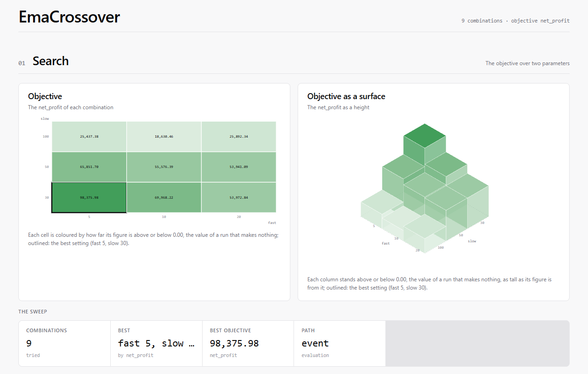
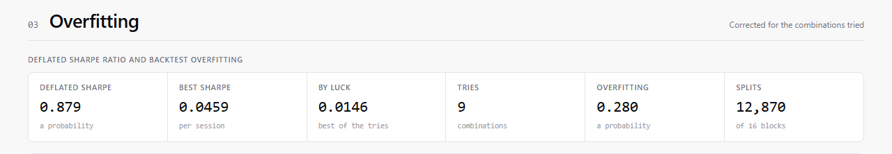

# Optimization

`bt.optimize` runs one strategy many times, once for every combination of the parameter values you list, and ranks the results. Each combination is an ordinary backtest with the same charges, slippage and rules, so you see which values would have worked best in the past.

## A first sweep

A **parameter** is a setting of the strategy with a default, such as `fast = 20`. The strategy is the EMA crossover on SBIN daily bars: buy when the fast EMA (an average of closing prices that weighs recent days more) crosses above the slow EMA, sell when it crosses back below. The sweep tries three fast and three slow lengths: 3 x 3 = 9 backtests.

Save the code as a file, for example `sweep.py`, and run it with `python sweep.py` (the next section says why). Put the API key from your OpenAlgo dashboard in place of `OPENALGO_API_KEY`.

<!-- requires-server -->
```python
# Imports: the backtest engine (bt), the OpenAlgo client (api) and the indicators (ta).
import openalgo.backtest as bt
from openalgo import api, ta

# Connect to your OpenAlgo server: the price history comes from it.
client = api(api_key="OPENALGO_API_KEY", host="http://127.0.0.1:5000")


# The strategy. A class bundles settings and functions; inside it, "self" is the strategy itself.
class EmaCrossover(bt.Strategy):
    symbol, exchange, interval = "SBIN", "NSE", "D"  # SBIN on NSE, daily bars
    fast = 20  # parameters: the sweep changes these
    slow = 50

    # init runs before the first bar: the two EMAs of the closing prices.
    def init(self):
        self.fast_ema = self.I(ta.ema, self.close, self.fast)
        self.slow_ema = self.I(ta.ema, self.close, self.slow)

    # on_bar runs at the close of every bar: buy, sell or wait.
    def on_bar(self, bar):
        if self.position.is_flat and self.fast_ema.crossed_above(self.slow_ema):
            self.buy()  # all the capital, at the next day's open
        elif self.position.is_long and self.fast_ema.crossed_below(self.slow_ema):
            self.exit()  # sell everything held


# The sweep runs only when you run this file itself (see the next section).
if __name__ == "__main__":
    sweep = bt.optimize(
        EmaCrossover, client, start="2021-01-01", end="2026-11-11", capital=100_000,
        fast=(5, 10, 20),  # the values to try for each parameter
        slow=(30, 50, 100),
        workers=2,  # how many backtests run at once; leave it out to use every CPU core
    )
    print(sweep.table.round(2).to_string(index=False))  # one row per combination
    print("best:", sweep.best)

    # The full backtest of the best values. "**" passes the dict as fast=..., slow=...
    best = sweep.select(**sweep.best)
    print(best.summary())  # net profit, return, drawdown and trades
```

<!-- output -->
```text
 fast  slow  net_profit  total_return  max_drawdown  sharpe  trades  objective
    5    30    98375.98          0.98         -0.25    0.72      28   98375.98
    5    50    65851.70          0.66         -0.28    0.55      25   65851.70
    5   100    25437.38          0.25         -0.29    0.30      17   25437.38
   10    30    69968.22          0.70         -0.23    0.57      23   69968.22
   10    50    55576.39          0.56         -0.26    0.49      19   55576.39
   10   100    18630.46          0.19         -0.28    0.25      14   18630.46
   20    30    53972.84          0.54         -0.25    0.48      17   53972.84
   20    50    53941.09          0.54         -0.29    0.47      11   53941.09
   20   100    25892.34          0.26         -0.26    0.31       9   25892.34
best: {'fast': 5, 'slow': 30}
Net profit   : Rs 98,375.98
Return       : 98.38%
Max drawdown : -25.15%
Trades       : 28 (39% won), 1 still open
Overfitting  : too few trades to judge (28 closed, 30 needed)
```

Reading it:

* `sweep.table` has one row per combination. `total_return` and `max_drawdown` are fractions: 0.54 is 54 percent. The **max drawdown** is the largest fall of the account from its highest value; the **Sharpe** ratio is the return per unit of day-to-day swings. `objective` is the figure the sweep ranks by, net profit by default.
* `sweep.best` is the combination with the highest objective.
* `sweep.select(...)` gives the full result of one combination, exactly what `bt.backtest` gives for those values, with its trades and report.

## Why must a sweep run from a file?

A sweep runs several backtests at once, each in a **worker process** (a separate copy of Python). Each worker reads your file to find the strategy class. `if __name__ == "__main__":` is true only in the copy you started, so the workers find the class without starting the sweep again.

* Run the sweep from a `.py` file. A class written in a notebook or typed at the Python prompt cannot be found by a worker; the sweep then stops with a `ConfigError` that tells you to move it into a file, or to pass `workers=1`.
* `workers=1` runs every combination in your own process, one after another: slower, but it works anywhere, notebooks included. The table is the same whatever the number of workers.

## How do I choose the values to try?

* Name each parameter with its values: `fast=(5, 10, 20)` (a tuple: values in round brackets), or `fast=range(5, 30, 5)` for 5, 10, 15, 20 and 25.
* Every combination runs, so the count multiplies: 5 fast values and 4 slow values are 20 backtests.
* `params={"slow": 50}` holds a parameter at one value while the others vary.
* Every other keyword is a `bt.backtest` argument (`start=`, `end=`, `capital=`, `costs=` and so on) and is the same for every combination. `capital=` is required.
* A name that is neither a parameter of the class nor a `bt.backtest` argument is an error, so a typing mistake cannot pass silently.

## How do I rank by something other than net profit?

Pass `objective=` with the name of any [metric](metric-definitions.md), such as `"sharpe"`, `"calmar"`, `"profit_factor"` or `"win_rate"`. The highest wins.

<!-- continues -->
<!-- requires-server -->
```python
if __name__ == "__main__":
    # The same 9 combinations, ranked by the Sharpe ratio instead of net profit.
    by_sharpe = bt.optimize(EmaCrossover, client, start="2021-01-01", end="2026-11-11", capital=100_000,
                            fast=(5, 10, 20), slow=(30, 50, 100), objective="sharpe", workers=2)
    print("best by Sharpe:", by_sharpe.best)
```

<!-- output -->
```text
best by Sharpe: {'fast': 5, 'slow': 30}
```

On SBIN over these years the same pair also had the best Sharpe ratio, so the winner did not change.

## How do I see the results as a grid?

`sweep.heatmap("fast", "slow")` lays the objective out as a table: one column per fast value and one row per slow value.

<!-- continues -->
<!-- requires-server -->
```python
if __name__ == "__main__":
    # Net profit of each pair, rounded to the rupee: fast across, slow down.
    print(sweep.heatmap("fast", "slow").round(0))
```

<!-- output -->
```text
fast       5        10       20
slow
30    98376.0  69968.0  53973.0
50    65852.0  55576.0  53941.0
100   25437.0  18630.0  25892.0
```

Every pair made money over these years, and the profit mostly fell as the averages got slower. Neighbouring cells agree, which is a better sign than one lone high number surrounded by poor ones.

## Is the best a lucky pick?


The overfitting figures of `bt.optimize` are new in openalgo 2.3.0: run `pip install -U openalgo` to update.


Try enough settings and one will look good by luck alone. From the backtests it already ran, every sweep also measures how far its best row may be luck; nothing runs again.

<!-- continues -->
<!-- requires-server -->
```python
if __name__ == "__main__":
    # The best setting's neighbours: the settings one step away from it in the grid.
    nb = sweep.neighbourhood
    print("Neighbourhood           :", nb.verdict)
    print(f"Neighbours making money : {nb.summary['profitable_share']:.0%}")
    print(f"Median neighbour keeps  : {nb.summary['median_ratio']:.0%}")
    print(f"25th percentile keeps   : {nb.summary['low_ratio']:.0%}")  # the neighbour a quarter of them fall below
    print("Warnings                :", sweep.warnings or "none")  # "or": none when the list is empty

    # Two figures corrected for the number of settings tried.
    print(f"Deflated Sharpe ratio   : {sweep.deflated_sharpe:.2f}")
    print(f"Overfitting probability : {sweep.overfitting_probability:.2f}")

    # The heatmap page: fast across, slow down.
    path = sweep.tearsheet("sweep.html", x="fast", y="slow")
    print("Open", path, "in your browser")
```

<!-- output -->
```text
Neighbourhood           : passed
Neighbours making money : 100%
Median neighbour keeps  : 67%
25th percentile keeps   : 62%
Warnings                : none
Deflated Sharpe ratio   : 0.88
Overfitting probability : 0.28
Open sweep.html in your browser
```

* **The neighbourhood** applies the [parameter neighbourhood](robustness.md#the-searching-checks) rule to the best row. Its neighbours are the settings one step away in the grid: fast 5 and slow 30 sit in a corner, so they have three (fast 5 with slow 50, fast 10 with slow 30, fast 10 with slow 50). The rule passes when about three quarters of the neighbours or more make money (the neighbour at the 25th percentile, with a quarter of them below it, is above break-even) and the median one (the middle one) keeps at least half of the best's figure. Here all three made money and the median kept 67 percent of the best's net profit: the best sits on a slope of good settings, not on a lone spike.
* **The warnings:** when the best fails that rule, `sweep.warnings` holds a line that starts "The best combination (...) looks like a lone spike, not a plateau" and says to prefer a setting inside a plateau. This sweep has none.
* **The deflated Sharpe ratio:** the best of 9 tries tends to show a higher Sharpe ratio than the strategy really has, because luck helped to pick it. This figure corrects for that: it is the probability, from 0 to 1, that the best setting's true Sharpe ratio is above what the best of 9 tries would show with no edge at all. Near 1 the best stands out from luck; near 0.5 or below it does not. Here it is 0.88, between the two: the best probably stands out from luck, but not clearly. The more settings you try, the higher the bar.
* **The overfitting probability** (the probability of backtest overfitting): the sweep cuts the 1,453 trading days into 16 blocks and takes every way of choosing half of them as "the past", 12,870 ways. In each, it finds the best setting on that half and ranks it on the other half. The figure is the share of ways in which the past's best landed in the bottom half. Here it is 0.28. Near 0.5 or above, the search picked settings that did not hold up across the years. A figure near 0 does not prove the settings hold: every half comes from the same years, so a setting that rode one long trend ranks well in all of them.
* `sweep.overfitting` gives both figures with what they rest on: the best's Sharpe ratio per day, the one the best of the tries would show by luck, the settings tried, the days, the blocks and the splits.

Passing proves nothing on its own: the [walk-forward](walk-forward.md#an-example) of this same sweep earned about a quarter of what its picks promised, so these figures are not a reason to trade the best row.

`sweep.tearsheet("sweep.html", x="fast", y="slow")` writes these figures to one page that opens in your browser. `x` and `y` name the two parameters to draw (the first two swept when you leave them out); any other parameter is held at its best value. The page starts with the net profit of every setting as a heatmap and as a surface, the best one outlined:

<figure><figcaption><p>The heatmap page: the net profit of every setting</p></figcaption></figure>

Below come the neighbourhood, with its verdict and a chart of the neighbours' net profits, and the overfitting figures:

<figure><figcaption><p>The deflated Sharpe ratio and the probability of backtest overfitting</p></figcaption></figure>

The tiles give the Sharpe ratios per trading day, not per year: the best setting's (0.0459), and the one the best of 9 tries would show by luck (0.0146). A chart under them shows how the past's best ranked in each of the 12,870 splits, and the Notes at the end of the page explain each figure.

## Should I trade the best values?

Not without a further test. The best row is the best fit to the past, not a forecast, and with enough combinations one will look good by luck. Prefer values whose neighbours in the grid also did well, keep the number of parameters small, and check the chosen values on years the sweep did not see. The [lesson on finding better settings](tutorial/09-find-better-settings.md) and [Tuning a Strategy](examples/ema-crossover-optimization.md) do this step by step: they optimize on 2021 to 2024 and check the winner on 2025 and 2026. [Walk-Forward](walk-forward.md) automates this, and [Robustness and Overfitting](robustness.md) runs seventeen checks on the settings you chose.

## More options

* **Your own objective:** `objective=profit_per_drawdown`, a function that takes a result and returns a number, defined with `def` at the top level of the file (not a `lambda`).
* **Lower is better:** `maximize=False` picks the lowest objective, for a figure such as `"ulcer_index"` (the neighbourhood is then not judged).
* **Values on the class:** `fast = bt.param(20, (5, 10, 20))`; values named in the call replace them.
* **A benchmark:** with `benchmark=`, `objective="alpha"` or `"information_ratio"` ranks against it.
* **The result:** `.table`, `.best`, `.select(**params)`, `.heatmap(x, y)`, `.objective`, `.plan` (the line reported before the sweep) and `.path`; and the overfitting figures `.neighbourhood`, `.warnings`, `.deflated_sharpe`, `.overfitting_probability`, `.overfitting` and `.tearsheet(path, x=, y=)`.
* **Progress:** `progress=print` prints the plan line (combinations, processes, time estimate) before the sweep starts.
* **Faster sweeps:** a [condition strategy](writing-strategies.md#can-i-write-the-rules-as-conditions) makes no Python call per bar and sweeps much faster.
* **Notebooks:** with the `cloudpickle` package installed, a class defined in a notebook can go to the workers.
* **Kept in your process:** your own `calendar=` or a cost object such as `bt.costs.flat(20)` cannot go to a worker, so the sweep runs in your process and the plan line says why.
