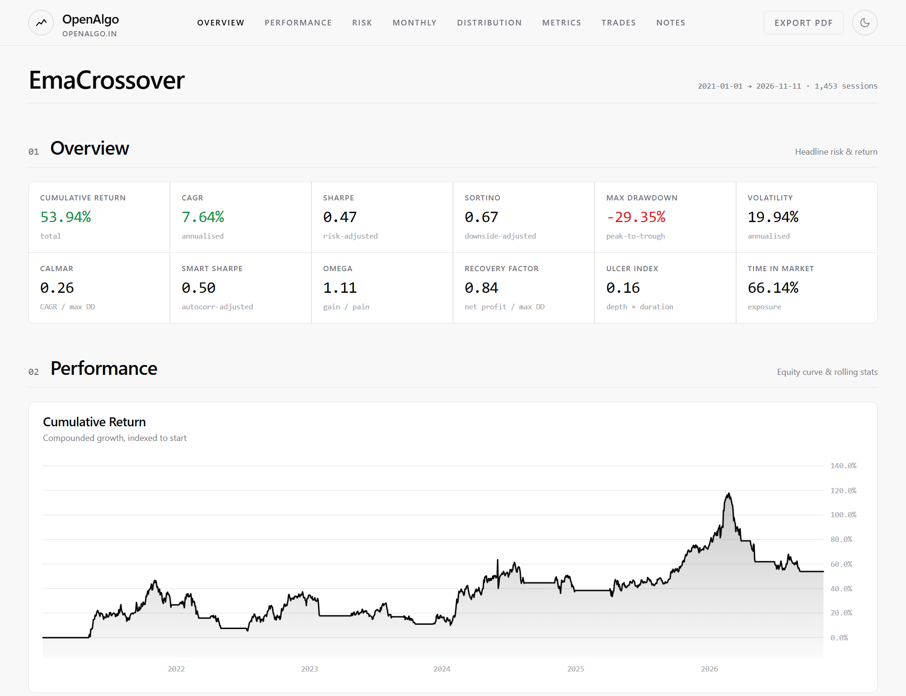

# Results and Reports

A backtest gives back a `result` that holds everything the run did: the trades, the value of your account over time, the performance figures and a report you open in your browser. This page shows how to read each of them, one question at a time, using the first strategy of this section.

The strategy is the EMA crossover from [Your First Backtest](tutorial/01-first-backtest.md). An EMA (exponential moving average) is the average closing price of recent days, with the latest days counting most. It buys SBIN when the 20-day EMA rises above the 50-day EMA and sells when it falls back below, on daily bars (one bar per trading day) from 1 January 2021 to 11 November 2026, with Rs 1,00,000. Put the API key from your OpenAlgo dashboard in place of `OPENALGO_API_KEY`, run this block first, and run the others after it in the same Python session: each one continues from the ones before.

<!-- requires-server -->
```python
# Load the backtest engine, the OpenAlgo client and the indicators (ta)
import openalgo.backtest as bt
from openalgo import api, ta

# Connect to your OpenAlgo server
client = api(api_key="OPENALGO_API_KEY", host="http://127.0.0.1:5000")


# The strategy. A class is a recipe; the engine follows it on every bar.
class EmaCrossover(bt.Strategy):
    symbol, exchange, interval = "SBIN", "NSE", "D"  # SBIN on NSE, daily bars
    fast = 20  # days in the fast EMA
    slow = 50  # days in the slow EMA

    # init runs before the first bar: it sets up the two EMAs
    def init(self):
        self.fast_ema = self.I(ta.ema, self.close, self.fast)  # self.I keeps the indicator up to date bar by bar
        self.slow_ema = self.I(ta.ema, self.close, self.slow)

    # on_bar runs at the close of every bar: it decides whether to buy or sell
    def on_bar(self, bar):
        if self.position.is_flat and self.fast_ema.crossed_above(self.slow_ema):  # no shares, fast EMA just rose above slow
            self.buy()  # buy with all the capital at the next day's open
        elif self.position.is_long and self.fast_ema.crossed_below(self.slow_ema):  # holding, fast EMA just fell below slow
            self.exit()  # sell all the shares at the next day's open


# Run the backtest on SBIN's daily bars from your OpenAlgo server
result = bt.backtest(EmaCrossover, client, start="2021-01-01", end="2026-11-11", capital=100_000)

# Print the summary.
print(result.summary())  # net profit, return, drawdown and trades
```

<!-- output -->
```text
Net profit   : Rs 53,941.09
Return       : 53.94%
Max drawdown : -29.35%
Trades       : 11 (36% won)
Overfitting  : too few trades to judge (11 closed, 30 needed)
```

What the four lines mean:

* **Net profit** is what the account gained, after all charges (brokerage, taxes and exchange fees).
* **Return** is the net profit as a share of the starting capital.
* **Max drawdown** is the largest fall of the account from its highest value so far: at its worst, the account was 29.35 percent below its peak.
* **Trades** counts the closed trades (a buy and the sell that closed it) and the share of them that made money. A position still open at the end is counted beside them ("2 still open"), and a run with no closed trade says "no closed trades".

`result.summary()` writes these lines as text. A run with `benchmark=` adds a fifth line with the benchmark's return (see [A benchmark](#a-benchmark)). `print(result)` prints something else: every setting the run used, its warnings and its P&L.

## The tables

Every list the run produced is a table (a pandas DataFrame) you can print, filter or save. The one you will read most is `result.trade_list()`, one row per closed trade, numbered from 1. The first five trades:

<!-- requires-server -->
<!-- continues -->
```python
# The closed trades, and the columns to show as a list of names
trades = result.trade_list()
columns = ["entry_time", "exit_time", "quantity", "entry_price", "exit_price", "net_pnl", "return_pct", "exit_reason"]

# head() keeps the first five rows; float_format prints 2 decimals
print(trades[columns].head().to_string(float_format="%.2f"))
```

<!-- output -->
```text
                     entry_time                 exit_time  quantity  entry_price  exit_price   net_pnl  return_pct exit_reason
trade
1     2021-05-11 09:15:00+05:30 2021-12-21 09:15:00+05:30    270.00       356.95      456.95  26742.48       27.75      signal
2     2022-01-11 09:15:00+05:30 2022-03-04 09:15:00+05:30    246.00       503.15      460.20 -10846.92       -8.76      signal
3     2022-04-06 09:15:00+05:30 2022-05-06 09:15:00+05:30    222.00       507.15      470.90  -8306.89       -7.38      signal
4     2022-07-13 09:15:00+05:30 2023-01-30 09:15:00+05:30    217.00       487.85      535.85  10153.37        9.59      signal
5     2023-04-28 09:15:00+05:30 2023-08-17 09:15:00+05:30    204.00       567.95      565.60   -752.17       -0.65      signal
```

How to read a row:

* `trade` is the trade's number. `entry_time` and `exit_time` are Indian time (IST): each trade was decided at a day's close and filled at the next day's open, 09:15.
* `quantity` is the number of shares, always whole shares unless the run asked for part shares (see [Whole shares or part shares?](costs-slippage-and-margin.md#whole-shares-or-part-shares)). It is never lots.
* `entry_price` and `exit_price` are the prices the trade was bought and sold at, in rupees, slippage included.
* `net_pnl` is the trade's profit or loss (P&L) in rupees after its charges, and `return_pct` that profit as a percent of the money put in (entry price x quantity): 10.0 is ten percent.
* `exit_reason` says why the trade closed: `signal` is the strategy's own `self.exit()`. A stop-loss shows `leg_sl` and a target `leg_target` (see [Stop-Loss and Target](tutorial/03-stop-loss-and-target.md)).

The trade list has more columns: `symbol`, `direction` (`long` or `short`), `product` (CNC, MIS or NRML), `gross_pnl` (before charges), `charges`, `bars_held` (bars from the entry to the exit; sessions on daily bars), `days_held` (calendar days) and `r_multiple` (the net P&L in units of the risk to the stop-loss, empty without a stop). The tearsheet's trade table shows the same rows.

Other tables: `result.orders` (every order, rejected ones with a `reject_code` that says why), `result.fills` (every executed order, its price and `slippage_rupees`, what slippage cost it) and `result.final_positions` (what was still held at the end).

## How far each trade went

While a trade is open, its profit rises and falls. The trade list keeps the worst and the best it reached, and what slippage cost it:

<!-- requires-server -->
<!-- continues -->
```python
# mae: the worst open loss of each trade, mfe: its best open profit, both in rupees before charges
columns = ["gross_pnl", "mae", "mfe", "mae_pct", "mfe_pct", "slippage"]
print(trades[columns].head().to_string(float_format="%.2f"))  # the first five trades, 2 decimals
```

<!-- output -->
```text
       gross_pnl       mae      mfe  mae_pct  mfe_pct  slippage
trade
1       27000.00   -594.00 50044.50    -0.62    51.93     54.00
2      -10565.70 -10565.70 11279.10    -8.54     9.11     61.50
3       -8047.50  -8047.50  3296.70    -7.15     2.93     55.50
4       10416.00  -2853.55 30748.90    -2.70    29.05     54.25
5        -479.40  -2886.60 11005.80    -2.49     9.50     61.20
```

* `mae` (maximum adverse excursion) is the lowest the trade's profit stood at while it was open, before charges: zero or negative. Trade 1 was at worst Rs 594 down.
* `mfe` (maximum favourable excursion) is the highest: zero or positive. Trade 1 was at best Rs 50,044.50 up but closed Rs 27,000 up: it gave back almost half. A winner that gives back most of its best open profit says the exits are late.
* `mae_pct` and `mfe_pct` are the same in percent of the trade's capital at work (entry price x the most shares held). Compare `mae_pct` with your stop-loss. With no stop, nothing closed trade 2 earlier: it fell 8.54 percent and closed at that loss when the EMAs crossed back.
* Only prices the trade could have seen while it was open count: the high and low of each day it was held through, and its own fill prices. In live trading (`bt.live`, not available yet) the same engine works these figures out from the ticks it receives, so a trade there can show a smaller MAE or MFE when the broker's feed did not show every price.
* `slippage` is what slippage cost the trade's buy and sell, in rupees. It is already in the prices and in the P&L, so it is shown, never taken off again.

`result.metrics` sums these up (`average_mae`, `average_mfe`, `edge_ratio`, `profit_kept`, `trading_cost` and more), and the tearsheet draws them: see [The Tearsheet](tearsheet.md#trades).

## The equity curve

The **equity curve** is the value of your account (cash plus the shares you hold) at the close of every day. `result.equity` holds it, one row per day. Its highest, lowest and last values:

<!-- requires-server -->
<!-- continues -->
```python
equity = result.equity["equity_rupees"]  # the account value column, one value per day
print(f"Highest : Rs {equity.max():,.2f} on {equity.idxmax().date()}")  # idxmax: the day of the highest value
print(f"Lowest  : Rs {equity.min():,.2f} on {equity.idxmin().date()}")
print(f"Last    : Rs {equity.iloc[-1]:,.2f} on {equity.index[-1].date()}")  # iloc[-1]: the last value
```

<!-- output -->
```text
Highest : Rs 217,898.05 on 2026-02-23
Lowest  : Rs 100,000.00 on 2021-01-01
Last    : Rs 153,941.09 on 2026-11-11
```

The account never fell below the starting Rs 1,00,000. It peaked at Rs 2,17,898.05 in February 2026 and ended at Rs 1,53,941.09: that fall of 29.35 percent from the peak is the max drawdown of the summary. The last trade closed on 8 September 2026, so the account then held only cash and its value stopped moving.

## Performance figures

`result.metrics` holds more than a hundred figures, read by name. A few worth knowing first:

<!-- requires-server -->
<!-- continues -->
```python
m = result.metrics
print(f"CAGR         : {m['cagr']:.2%}")  # the growth rate per year
print(f"Sharpe ratio : {m['sharpe']:.2f}")  # return for the risk taken; higher is better
print(f"Exposure     : {m['exposure']:.0%}")  # share of the time a position was open
print(f"Profit factor: {m['profit_factor']:.2f}")  # rupees won for every rupee lost
print(f"Charges      : Rs {m['total_costs']:,.2f}")  # all charges of the closed trades
```

<!-- output -->
```text
CAGR         : 7.64%
Sharpe ratio : 0.47
Exposure     : 66%
Profit factor: 1.95
Charges      : Rs 3,322.91
```

Returns, rates and drawdowns are stored as fractions (0.0764 is 7.64 percent); the `:.2%` in the f-string prints them as percents. [Metrics Explained](metrics-explained.md) explains every figure in plain words, and [Metric Definitions](metric-definitions.md) gives its formula.

## Year by year

The return of each calendar year, as a percent:

<!-- requires-server -->
<!-- continues -->
```python
# A for loop runs the indented line once for each item; items() gives each year with its return
for year, value in result.performance.yearly_returns.items():
    print(year, f"{value:7.2%}")
```

<!-- output -->
```text
2021  26.74%
2022   6.34%
2023 -13.50%
2024  18.83%
2025  26.45%
2026 -12.12%
```

## The HTML tearsheet

A **tearsheet** is the full report of a backtest on one HTML page, laid out as a dashboard. `result.tearsheet(path)` writes it and returns the file name; open the file in your browser. Everything is inside the one file, so it opens without an internet connection and you can send it to someone as it is. [The Tearsheet](tearsheet.md) walks through every section, with a screenshot of each.

<!-- requires-server -->
<!-- continues -->
```python
print(result.tearsheet("sbin_ema_crossover.html"))  # writes the report next to your script
```

<!-- output -->
```text
sbin_ema_crossover.html
```

<figure><figcaption><p>The top of the tearsheet for the SBIN EMA 20/50 crossover, in the light theme</p></figcaption></figure>

At the top, a header links to each section and has an **Export PDF** button (your browser's print) and a switch between a light and a dark page. Below it come numbered sections:

| Section | What it shows |
|---|---|
| Overview | The headline figures as tiles: cumulative return, CAGR, Sharpe, max drawdown, volatility and more |
| Performance | The cumulative return (with the benchmark's line when the run has one), the rolling Sharpe ratio, volatility and win rate, CAGR, max drawdown and Sharpe over the last month, year and longer, and the returns of the latest periods |
| Risk | The drawdown chart, the risk figures, the ten worst drawdowns and the losing streaks of days; with a benchmark, beta, alpha and the rolling beta |
| Monthly | The monthly and weekly returns as coloured grids (heatmaps), and each year's return against the benchmark |
| Distribution | How the daily returns spread: a histogram and a box plot |
| Metrics | Every figure in one table you can sort, with the benchmark's beside it |
| Trades | The trade figures, the trading cost (charges plus slippage), the MAE and MFE of the trades as tiles, histograms and scatter charts, the trade list of `result.trade_list()` (sort it by any column, page by page), the charges by component and the R-multiples of trades opened with a stop-loss |
| Overfitting checks | The four [quick checks](#overfitting-checks) of the closed trades, each with its figure, rule and verdict |
| Notes | How the figures were worked out, every setting the run used and every warning |

What to look at first: the Overview tiles for the return and the max drawdown, the cumulative return chart in Performance (did the account grow steadily, or in one lucky stretch?), the drawdown chart in Risk (how deep and how long were the bad patches?), the trade list in Trades, and the warnings at the end of Notes. Under a tile, a second figure is the benchmark's, measured the same way, when the run has a benchmark. Hover over a chart to read its values.

`mode=` writes a part of the same page:

| `mode=` | What the page holds |
|---|---|
| `"full"` (the default) | Every section |
| `"basic"` | The Overview, the cumulative return and period returns, the drawdown chart and the worst drawdowns, the monthly heatmap and the yearly returns, the trades, the trading cost, the MAE and MFE histograms and the charges, the overfitting checks, and the Notes |
| `"metrics"` | Every figure with its value and definition, and the settings the run used |
| `"charts"` | Every chart and nothing else, the MAE and MFE histograms and scatter charts included |

`log_scale=True` draws the cumulative return on a log scale, which reads better on long runs.

## A benchmark

A **benchmark** is what you compare the strategy with. Would simply holding the NIFTY 50 index have done better? `result.rerun(benchmark="NIFTY")` runs the same backtest again with NIFTY's daily closes from your OpenAlgo server, and adds the comparison figures:

<!-- requires-server -->
<!-- continues -->
```python
# The same backtest, compared with NIFTY 50
vs_nifty = result.rerun(benchmark="NIFTY")
m = vs_nifty.metrics
print(f"Strategy return : {m['total_return']:.2%}")
print(f"NIFTY return    : {m['benchmark_total_return']:.2%}")
print(f"Beta            : {m['beta']:.2f}")  # how strongly the strategy moved with NIFTY
```

<!-- output -->
```text
Strategy return : 53.94%
NIFTY return    : 80.63%
Beta            : 0.71
```

Over these years the crossover made less than simply holding NIFTY 50. A beta of 0.71 means that on an average day it moved about 0.7 percent for each 1 percent move of NIFTY. The lesson [Compare with NIFTY](tutorial/08-compare-with-nifty.md) explains alpha, beta and the NIFTY line on the tearsheet.

## Overfitting checks

A strategy tuned to one stretch of history can look best exactly where it will not hold. Every backtest therefore has four quick checks of its closed trades. They are worked out the first time you read them (in `result.summary()`, `result.warnings` or the tearsheet), never while the backtest runs, and they change none of its figures:

* **Random out of sample**: 30 percent of the sessions are set aside at random, 200 times. The check passes when, in at least 80 percent of these draws, the set-aside sessions keep at least half of the Sharpe ratio of the others.
* **Trade reshuffle**: the same closed trades in 200 random orders, to show the drawdowns they could have given. It only reports, unless you give it a largest drawdown you accept.
* **Trade resample**: 200 paths of trades drawn at random from your own, a trade may come more than once. The check passes when at least 95 percent of the paths make money and at most 5 percent fall 50 percent from a peak.
* **Variance**: the same paths with the win rate 5 points lower. The check passes when at least 80 percent of them still make money.

A check needs at least 30 closed trades and a run that made money. Otherwise it says "not judged" and why, and it never passes.

`result.summary()` sums them up in its Overfitting line. The SBIN run above closed 11 trades, so it reads `too few trades to judge (11 closed, 30 needed)`. The [MACD crossover example](examples/macd-crossover.md), with 52 trades, reads `quick checks: 3 failed (random_out_of_sample, resample, variance), 1 informational`. Each failed check also adds a line to `result.warnings` with its figures and its rule.

How to read them:

* Passing proves nothing on its own.
* A failure says the edge did not hold up under that check: it may be fitted to the past, or too small to tell apart from the luck of the run's own trades. It is not proof that the strategy is overfitted.
* None of these four can see a strategy picked as the best of many settings tried. If you chose the settings with [Optimization](optimization.md), test them on dates the search did not see: [Walk-Forward](walk-forward.md) does that for you.

`result.robustness()` runs the full set of seventeen checks, the ones that can see a pick from many settings among them, with charts and an HTML report: see [Robustness and Overfitting](robustness.md).

## Warnings

`result.warnings` lists what you should know about a run, most important first:

<!-- requires-server -->
<!-- continues -->
```python
for warning in result.warnings:  # print each warning on its own line
    print(warning)
```

<!-- output -->
```text
SBIN: generic cash-equity instrument assumed (lot 1, tick 0.05)
charges: the NSE_EQ_DELIVERY rates of cost schedule IN-2021-01-01 used for 2021-01-01 were never verified against their source, so the charges may be off. Until 2021-03-31 NSE charged EQ-series shares outside the NIFTY 50 and NIFTY Next 50 Rs 2.75 per lakh (NSE/FA/46225) and the shares of those two indices this standard rate. The engine does not know an index's members, so the row is unverified.
```

This run has two. The first says SBIN was traded with the usual terms of a share, a lot of 1 share and a tick (the smallest price step) of 5 paise; you will see it on every share you backtest, and it needs no action. The second says the delivery charges of January to March 2021 are not verified: until 31 March 2021 NSE charged shares outside the NIFTY 50 and NIFTY Next 50 a lower rate, and the engine does not know which shares were in those indices. SBIN is a NIFTY 50 share, so its charges are right. Python also prints this one, as an `UnverifiedScheduleWarning`, when the run ends.

Other warnings you may meet:

* A run in which the engine refused or skipped orders you did not plan for ends with one `OrdersNotPlacedWarning`, printed by Python, with how many and the most common reason, for example `3 of 3 orders were rejected because a delivery (CNC) short is not allowed in Indian cash markets (reject_code 'product_rule'). See result.warnings.` `result.warnings` then has a line for each reason, with what to do. Orders kept out by a rule you set (the entry window, the daily loss limit, a cooldown) are only counted in `result.warnings`. See [Why was my order rejected?](orders-and-risk.md#why-was-my-order-rejected)
* A strategy that had to wait inside the run for its indicators, because the data had too few bars before `start`, ends with a `WarmUpWarning`, printed by Python, that says when it first decided; `result.warnings` says how many bars it waited and why (see [History before the start date](data.md#history-before-the-start-date)).

`print(result)` shows the warnings together with every setting the run used, among them the `warm_up` line: what each indicator needed, the history loaded before `start` and when the strategy first decided.

## Saving to Excel or CSV

`result.to_csv("results")` writes every table as a CSV file into the folder `results` and returns the paths:

<!-- requires-server -->
<!-- continues -->
```python
paths = result.to_csv("results")
print([path.name for path in paths])  # the file names
```

<!-- output -->
```text
['fills.csv', 'orders.csv', 'trades.csv', 'positions.csv', 'equity.csv', 'events.csv', 'stale_marks.csv', 'costs.csv', 'contract_notes.csv']
```

`result.to_excel("backtest.xlsx")` writes the same tables to one workbook, a sheet per table. It needs `pip install openpyxl`.

## Reproducing a run

`result.rerun()` runs the same backtest again with the same strategy, client and settings, and gives an identical result. Pass a strategy setting to try other numbers without editing the class. Here, faster EMAs:

<!-- requires-server -->
<!-- continues -->
```python
faster = result.rerun(fast=10, slow=30)  # 10-day and 30-day EMAs instead of 20 and 50
print(faster.summary())  # net profit, return, drawdown and trades
```

<!-- output -->
```text
Net profit   : Rs 69,968.22
Return       : 69.97%
Max drawdown : -23.24%
Trades       : 23 (39% won), 1 still open
Overfitting  : too few trades to judge (23 closed, 30 needed)
```

To try many numbers at once and rank them, see [Find Better Settings](tutorial/09-find-better-settings.md).

## Monte Carlo

A backtest is one path through history. `result.monte_carlo()` asks how it might have gone with the same days in another order: it reshuffles the daily returns into many other paths and reports the spread. The 5th percentile is a bad case (one path in twenty did worse), the 50th a typical one and the 95th a good one:

<!-- requires-server -->
<!-- continues -->
```python
study = result.monte_carlo(simulations=1000, seed=7)  # seed: the same shuffle every time
print(study.percentiles.loc[[0.05, 0.5, 0.95], ["final_return", "max_drawdown"]].round(4))
```

<!-- output -->
```text
            final_return  max_drawdown
percentile
0.05             -0.3129       -0.5489
0.50              0.6283       -0.3264
0.95              2.4096       -0.2029
```

The figures are fractions (0.6283 is 62.83 percent). Read it like this: the real run made 53.94 percent. With its days reshuffled, the middle (50th percentile) return was 62.83 percent and the middle drawdown 32.64 percent, but one path in twenty lost 31.29 percent or more. Results this spread out need a long test before you trust them. The tearsheet does not draw this study; call `result.monte_carlo()` for it.

## More options

* **Every table:** `result.trade_list()` (the closed trades as a trader reads them), `result.trades` (the same trades in the engine's own columns: `entry_units`, `net_pnl_rupees`, `initial_risk_rupees`, `mae_rupees`, `mfe_rupees`, `mae_pct`, `mfe_pct`, `slippage_rupees` and more), `fills`, `orders`, `positions` (each change of a position), `equity`, `returns`, `events` and `risk_events`, `final_positions`, `stale_marks`, `costs` (each fill's charges, item by item), `contract_notes`, `skipped` (orders sized to zero), `settlements` and `rolls` (futures), `r_summary`, `gross_pnl` and `to_dataframes()`. Times are IST; columns ending in `_ts` are the same instants in UTC nanoseconds; prices are rupees; quantities are units, never lots.
* **Every figure, with its definition:** `result.metrics_table()` returns a table with the group, label, value, unit and definition of each figure.
* **The series behind the figures:** `result.performance` has `drawdown`, `drawdown_details(top=5)`, `monthly_returns`, `rolling`, `horizons` (the last 1, 3 and 6 months, 1, 3 and 5 years), `losing_streaks`, `cost_breakdown` and, with a benchmark, `benchmark_comparison("year")`. See [Metrics](support-functions/metrics.md).
* **How the figures are measured:** from your capital and the open of the first bar; drawdowns are zero or negative; returns are per trading session, annualised with the real number of NSE sessions in each year (not a fixed 252); CAGR uses 365.25 calendar days a year and is not given for runs shorter than 28 days; net figures are after every charge; trade figures count closed trades only; the risk-free rate is 0 (pass one to [`metrics.analyse`](support-functions/metrics.md)); a figure the data cannot define is NaN.
* **Other benchmarks:** `benchmark=("SENSEX", "BSE_INDEX")`, or a pandas Series of your own closes. A day without a benchmark close stays missing; it is never filled from a neighbouring day.
* **The tearsheet:** without a path, `result.tearsheet()` returns the HTML as text. It reads in full with scripts turned off in the browser (the theme switch, sorting and paging then do nothing). `openalgo.backtest.report.tearsheet(performance, path)` renders figures you computed yourself.
* **Monte Carlo options:** `resample="trades"` reshuffles the closed trades instead of the days; `bust=-0.30` and `goal=0.25` add the share of paths that fell 30 percent or gained 25 percent. See [Metrics](support-functions/metrics.md#monte-carlo).
* **R-multiples:** for trades opened with a stop-loss, `result.trades` has `initial_risk_rupees` (what the stop would have lost) and `r_multiple` (the trade's net P&L in units of that risk), and `result.r_summary` sums them up.
* **Where a run ends:** at the earliest of `end`, the close of the last bar in the data and the present; a warning names the end used. A position still open is reported open, valued at the last close. `bt.backtest(now="2026-11-11 12:00")` fixes the present, to replay a day as it stood at noon.
* **The manifest:** `result.manifest` records the engine version, the strategy's source hash and parameters, every argument, a hash of the bars used and the platform, as plain JSON. It never holds your API key. When the data has changed since, the first warning of `result.rerun()` says the rerun is not a reproduction.
