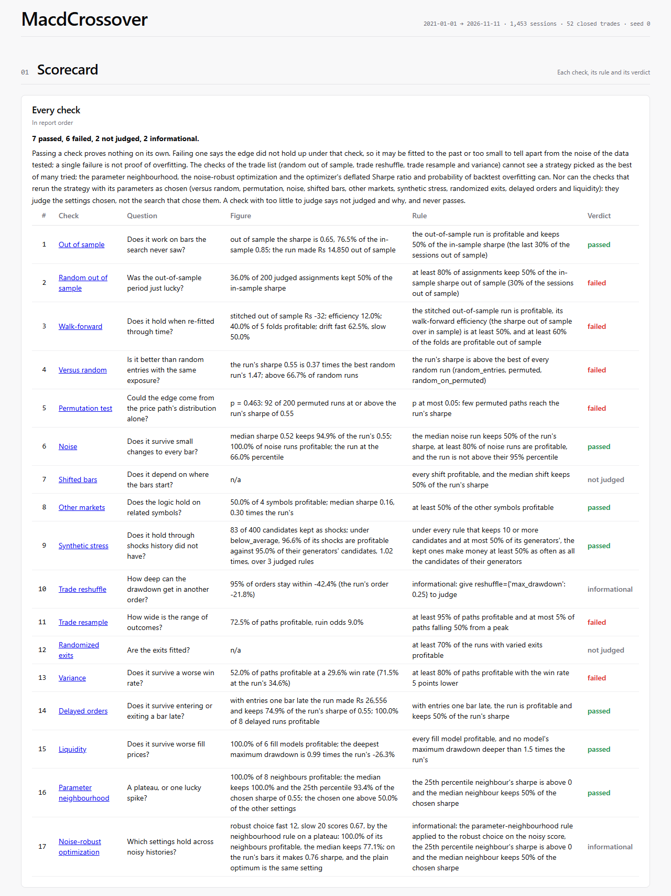
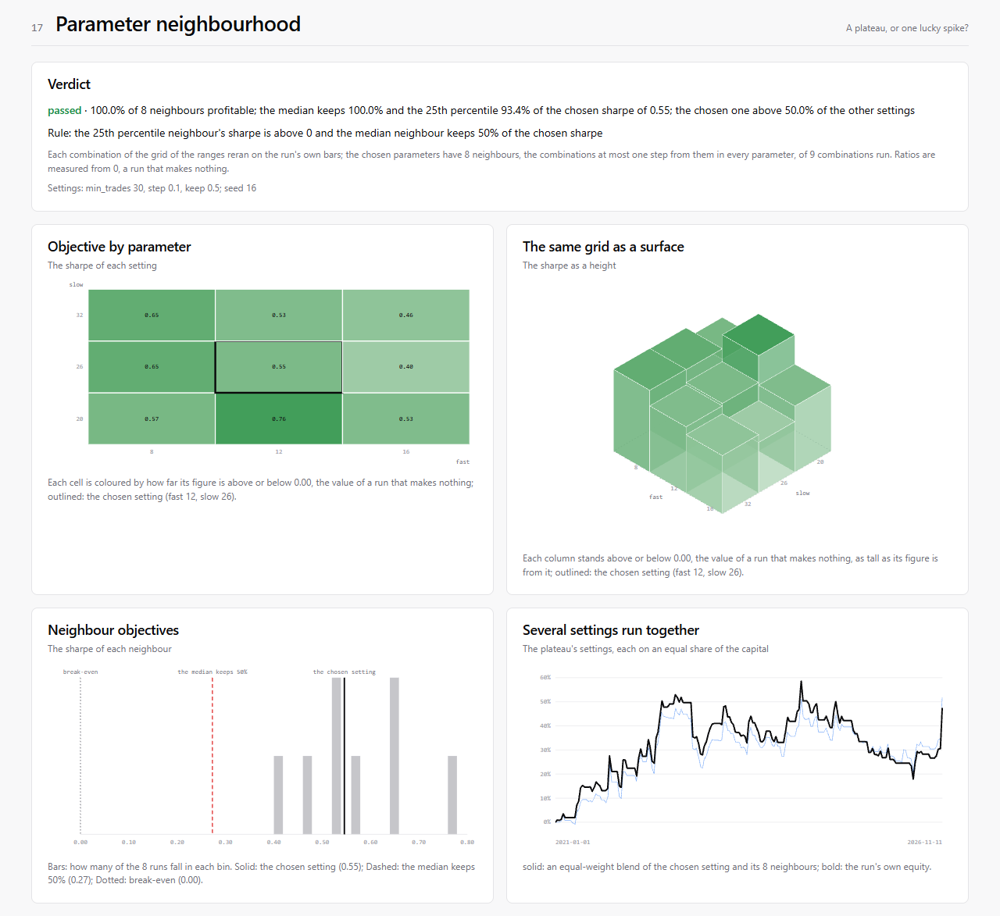
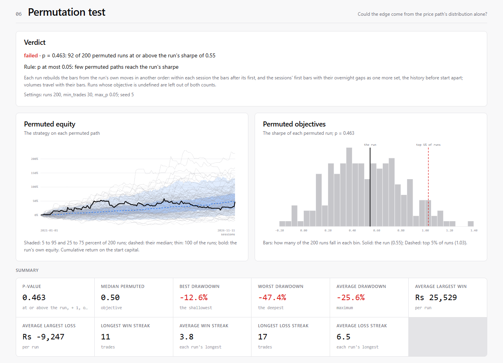

# Robustness and Overfitting

A backtest shows what a strategy would have done on one stretch of history. **Overfitting** is fitting a strategy's rules and settings so closely to that stretch that they pick up its noise: the random ups and downs that will not come again. An overfitted strategy looks its best on the very prices it was fitted to, and from now on it will trade other prices. That is why a good backtest can still lose money live:

* **Settings picked as the best of many tries.** Try a hundred pairs of EMA lengths and one will look good by luck alone. The best row of a sweep is the best fit to the past, not a forecast.
* **Too few trades.** Eleven trades in six years can come out well or badly by chance. The fewer the trades, the harder it is to tell a real edge from luck.
* **One lucky stretch.** A strategy that made its money in one long trend has an edge only if that kind of trend comes again.
* **Fills the market may not give.** A profit that needs the exact opening price, or an order filled the very bar after the signal, can vanish with a slightly worse fill or a late order.

The robustness checks test each of these, so you can catch overfitting at the backtest stage, before any money is at risk. This page shows how to run them and how to read what they say.


The full set of checks, `bt.robustness` and `bt.walk_forward` are new in openalgo 2.3.0: run `pip install -U openalgo` to update.


## How to read a verdict

Each check asks one question, states a pass rule and gives one of four verdicts:

* **passed:** the strategy did not fail this test. Passing proves nothing on its own: an overfitted strategy can pass some checks.
* **failed:** the edge did not hold up under this check. It may be fitted to the past, or too small to tell apart from luck. A failure is a warning, not proof that the strategy is overfitted.
* **not judged:** there was too little to judge (too few trades, not enough history, no other symbols named), or the run made no money, so it has no edge to judge; the check says why. "Not judged" never counts as a pass.
* **informational:** the check shows its figures but judges nothing: the trade reshuffle until you give it a limit, and the noise-robust optimization, which shows which settings hold up rather than judging yours.

Only some checks can see settings that you picked as the best of many tries: **out of sample** and **walk-forward** (given parameter ranges, they repeat the search on part of the history and test the winner on the rest), the **parameter neighbourhood**, the **noise-robust optimization**, and the optimizer's [deflated Sharpe ratio and probability of backtest overfitting](optimization.md#is-the-best-a-lucky-pick) (the **Sharpe ratio** is the return per unit of day-to-day ups and downs). The other checks judge the settings you give them, not the search that chose them. If you chose the settings with a sweep, run those four.

## The quick checks on every backtest

Every backtest already has four of the checks, worked out from its closed trades at no extra cost: random out of sample, trade reshuffle, trade resample and variance. `result.summary()` sums them up in its Overfitting line, `result.warnings` adds a line for each one that fails, and the tearsheet has a section for them. [Overfitting checks](results-and-reports.md#overfitting-checks) explains them. They need at least 30 closed trades, and they cannot see settings picked from many tries. The full set adds thirteen more checks.

## Run the checks on your strategy

`result.robustness()` runs every check on a finished backtest, with the same settings the backtest used. This is the EMA crossover of [Your First Backtest](tutorial/01-first-backtest.md): SBIN daily bars from 1 January 2021 to 11 November 2026 and Rs 1,00,000. Put the API key from your OpenAlgo dashboard in place of `OPENALGO_API_KEY`, save the code as a file, for example `checks.py`, and run it with `python checks.py`.

<!-- requires-server -->
```python
# Load the backtesting engine (bt), the OpenAlgo client (api) and the indicators (ta).
import openalgo.backtest as bt
from openalgo import api, ta

# Connect to your OpenAlgo server.
client = api(api_key="OPENALGO_API_KEY", host="http://127.0.0.1:5000")


# The strategy of lesson 1. A class groups the strategy's settings and steps under one name.
class EmaCrossover(bt.Strategy):
    symbol, exchange, interval = "SBIN", "NSE", "D"  # SBIN on NSE, daily bars
    fast = 20  # days in the fast EMA
    slow = 50  # days in the slow EMA

    # init runs before the first bar: the two EMAs of the closing prices.
    def init(self):
        self.fast_ema = self.I(ta.ema, self.close, self.fast)
        self.slow_ema = self.I(ta.ema, self.close, self.slow)

    # on_bar runs at the close of every bar: buy, sell or wait.
    def on_bar(self, bar):
        if self.position.is_flat and self.fast_ema.crossed_above(self.slow_ema):
            self.buy()  # with all the capital, at the next day's open
        elif self.position.is_long and self.fast_ema.crossed_below(self.slow_ema):
            self.exit()  # sell all the shares at the next day's open


# Some checks run backtests in worker processes (separate copies of Python), so the
# checks start only when you run this file itself; see the note under the next example.
if __name__ == "__main__":
    result = bt.backtest(EmaCrossover, client, start="2021-01-01", end="2026-11-11", capital=100_000)

    # Run all seventeen checks on this backtest.
    report = result.robustness(
        runs=200,  # alternative runs of each check; leave it out for 1000
        workers=2,  # backtests run at once; leave it out to use every CPU core
    )
    print(report)  # how many checks passed, failed or were not judged

    # Why they were not judged: report.check(name) is one check, .note its explanation.
    print(report.check("resample").note)
    print(report.check("shifted").note)
    print(report.check("other_markets").note)
    print(report.check("walk_forward").note)
```

<!-- output -->
```text
RobustnessReport(EmaCrossover: 17 not judged)
Too few trades to judge: 11 closed trades, 30 needed.
The strategy bars are the base bars (D on D), so there is nothing to shift: run the strategy on finer base bars (base='1m') to judge it.
No related symbols given: name them with others=['ICICIBANK', 'HDFCBANK'].
Nothing to re-fit: give ranges named after the strategy's parameters (fast=range(5, 30, 5)) or declare them with bt.param(default, values).
```

None of the seventeen checks could judge this strategy, and that is the first thing they tell you:

* Thirteen checks stopped at the minimum of 30 closed trades (three of the other four need 30 too, once they have what the next bullets name), and this run closed 11 in almost six years. With so few trades, no test can tell the crossover's profit apart from luck. The profit may be real, but this backtest cannot show it.
* **Shifted bars** needs bars finer than the strategy's own, to build the days with other start and end times.
* **Other markets** needs the symbols to try, named with `others=`.
* **Walk-forward** and the **noise-robust optimization** search the strategy's settings, so they need ranges of values to try (the next example gives them).

Do not lower the 30-trade minimum to get a verdict. More trades come from a strategy that trades more often, from more history, or from the same rules on more symbols.

## A strategy with enough trades

The [MACD crossover](examples/macd-crossover.md) on ICICIBANK closes 52 trades over the same dates. Here its two EMA lengths are parameters (`fast` and `slow`), so the checks that search can try the values around them. `bt.robustness` runs the backtest and then the checks, in one call.

<!-- requires-server -->
```python
# Load textwrap (Python's own tool for wrapping long lines of text), the backtesting
# engine (bt), the OpenAlgo client (api) and the indicators (ta).
import textwrap

import openalgo.backtest as bt
from openalgo import api, ta

# Connect to your OpenAlgo server.
client = api(api_key="OPENALGO_API_KEY", host="http://127.0.0.1:5000")


# The MACD crossover of the examples, with the EMA lengths as parameters.
class MacdCrossover(bt.Strategy):
    symbol, exchange, interval = "ICICIBANK", "NSE", "D"  # ICICIBANK on NSE, daily bars
    fast = 12  # days in the MACD's fast EMA
    slow = 26  # days in its slow EMA

    # init runs before the first bar. ta.macd gives three lines: the MACD line,
    # its signal line (a 9-day EMA of it) and the histogram (unused here).
    def init(self):
        self.macd, self.signal, self.histogram = self.I(ta.macd, self.close, self.fast, self.slow, 9)

    # on_bar runs at the close of every bar: buy, sell or wait.
    def on_bar(self, bar):
        if self.position.is_flat and self.macd.crossed_above(self.signal):
            self.buy()  # with all the capital, at the next day's open
        elif self.position.is_long and self.macd.crossed_below(self.signal):
            self.exit()  # sell all the shares at the next day's open


if __name__ == "__main__":
    # Backtest the strategy once, then run all seventeen checks on it.
    report = bt.robustness(
        MacdCrossover, client, start="2021-01-01", end="2026-11-11", capital=100_000,
        fast=(8, 12, 16),  # the values the searching checks try for each parameter
        slow=(20, 26, 32),
        others=["HDFCBANK", "AXISBANK", "KOTAKBANK", "SBIN"],  # symbols for "other markets"
        runs=200,  # alternative runs of each check; leave it out for 1000
        workers=2,  # backtests run at once; leave it out to use every CPU core
    )
    print(report)  # how many checks passed, failed, were not judged or only inform

    # One line per check: its number, its name and its verdict, then the figure it judged.
    # report.verdicts is a table with a row per check; iterrows() gives each row in turn.
    for number, row in report.verdicts.iterrows():
        # An f-string (f"...") fills in each {...}; :>2 and :<20 pad the number and the
        # name to 2 and 20 characters, so the columns line up.
        print(f"{number:>2} {row['check']:<20} {row['verdict']}")
        # The figure, wrapped at 86 characters and indented by 3 spaces.
        print(textwrap.fill(row["figure"], width=86, initial_indent="   ", subsequent_indent="   "))

    # The HTML report, with a chart or a table for every check.
    path = report.tearsheet("macd_robustness.html")
    print("Open", path, "in your browser")
```

<!-- output -->
```text
RobustnessReport(MacdCrossover: 7 passed, 6 failed, 2 not judged, 2 informational)
 1 out_of_sample        passed
   out of sample the sharpe is 0.65, 76.5% of the in-sample 0.85; the run made Rs
   14,850 out of sample
 2 random_out_of_sample failed
   36.0% of 200 judged assignments kept 50% of the in-sample sharpe
 3 walk_forward         failed
   stitched out of sample Rs -32; efficiency 12.0%; 40.0% of 5 folds profitable; drift
   fast 62.5%, slow 50.0%
 4 vs_random            failed
   the run's sharpe 0.55 is 0.37 times the best random run's 1.47; above 66.7% of
   random runs
 5 permutation          failed
   p = 0.463: 92 of 200 permuted runs at or above the run's sharpe of 0.55
 6 noise                passed
   median sharpe 0.52 keeps 94.9% of the run's 0.55; 100.0% of noise runs profitable;
   the run above 66.0% of the noise runs and not above their 95th percentile 0.62
 7 shifted              not judged
   n/a
 8 other_markets        passed
   50.0% of 4 symbols profitable; median sharpe 0.16, 0.30 times the run's
 9 stress               passed
   83 of 400 candidates kept as shocks; under below_average, 96.6% of its shocks are
   profitable against 95.0% of their generators' candidates, 1.02 times, over 3 judged
   rules
10 reshuffle            informational
   95% of orders stay within -42.4% (the run's order -21.8%)
11 resample             failed
   72.5% of paths profitable, ruin odds 9.0%
12 random_exits         not judged
   n/a
13 variance             failed
   52.0% of paths profitable at a 29.6% win rate (71.5% at the run's 34.6%)
14 delayed              passed
   with entries one bar late the run made Rs 26,556 and keeps 74.9% of the run's
   sharpe of 0.55; 100.0% of 8 delayed runs profitable
15 liquidity            passed
   100.0% of 6 fill models profitable; the deepest maximum drawdown is 0.99 times the
   run's -26.3%
16 parameters           passed
   100.0% of 8 neighbours profitable; the median keeps 100.0% and the 25th percentile
   93.4% of the chosen sharpe of 0.55; the chosen one above 50.0% of the other
   settings
17 noise_optimization   informational
   robust choice fast 12, slow 20 scores 0.67, by the neighbourhood rule on a plateau:
   100.0% of its neighbours profitable, the median keeps 77.1%; on the run's bars it
   makes 0.76 sharpe, and the plain optimum is the same setting
Open macd_robustness.html in your browser
```

The checks run about 1,300 backtests here, two at a time; the whole report took about 70 seconds on the desktop these pages were made on. Like [a parameter sweep](optimization.md#why-must-a-sweep-run-from-a-file), it must run from a `.py` file: with `workers=1` it runs in your own process, notebooks included, more slowly.

With `progress=print` the checks first print their plan: which checks run, how many backtests they need, and an estimate of the time. For this run it read (a **session** is a trading day; the times differ from one computer to another):

```text
bt.robustness: 17 checks of 17 for MacdCrossover (out_of_sample, random_out_of_sample, walk_forward, vs_random, permutation, noise, shifted, other_markets, stress, reshuffle, resample, random_exits, variance, delayed, liquidity, parameters, noise_optimization), 200 runs each from seed 0, on 52 closed trades over 1,453 sessions. The trade-list checks read the run's trade list; the bar and searching checks rerun the backtest 1,338 times or fewer on generated bars, other symbols or the run's own bars with one setting changed, or the run's own bars over parameter combinations or windows of the run (out_of_sample 11, walk_forward 50, vs_random 600, permutation 200, noise 200, other_markets 4, stress 400, delayed 8, liquidity 6, parameters 9, noise_optimization 459), each an ordinary backtest of the same kernel. The checks share 600 of the runs listed, which read the same generated bars, so the total counts each once. The searching checks share 9 of their runs, the same combinations on the same bars, so the total counts each once. The backtest took 0.36 s. A rerun on generated bars took 0.07 s, making its bars and measuring it included; in 2 worker processes the reruns should take about 50.2 s. That many reruns suit the condition form (entry_when, exit_when), which runs without a Python call per bar.
```

The last sentence suggests the [condition form](writing-strategies.md#can-i-write-the-rules-as-conditions) of a strategy, which makes no Python call per bar and reruns much faster.

## Reading the MACD report

The checks measure the Sharpe ratio unless you choose another figure with `objective=`. The run's Sharpe ratio was 0.55.

**What held up.** The result does not hang on one exact detail:

* **Parameter neighbourhood:** all 8 settings around fast 12 and slow 26 made money. The **median** one (the middle one, with as many settings above it as below) matched the chosen Sharpe ratio, and the one at the 25th **percentile** (a quarter of the settings below it) kept 93.4 percent of it. The chosen setting sits on a plateau, not on a lone spike.
* **Noise:** with the prices of every bar moved a little at random, all 200 noisy histories made money, and their median kept 94.9 percent of the Sharpe ratio.
* **Delayed orders** and **liquidity:** entering one bar late still made Rs 26,556, and every other fill price made money.
* **Out of sample:** searched on the first 70 percent of the sessions alone, the best setting (fast 12, slow 20) made money on the last 30 percent it never saw, keeping 76.5 percent of its Sharpe ratio.
* **Other markets** passed at its limit: 2 of the 4 other banks made money.
* **Synthetic stress:** 83 of the 400 noisy and shuffled histories were harsher than the real one (a deeper fall, a longer wait for a new high or a deeper drop below the 200-day average), and the strategy made money on them about as often as on all of them: under the weakest rule, 96.6 percent of the harsh histories made money against 95.0 percent of all of them.

**What did not.** The edge is small next to luck:

* **Versus random:** a third of the random runs (random entries that hold trades as long as the strategy's, and the strategy on shuffled prices) did as well or better: the run beat 66.7 percent of them, and the best had a Sharpe ratio of 1.47.
* **Permutation test:** the same daily moves of ICICIBANK put in another order gave the strategy at least the same Sharpe ratio in 92 of 200 shuffled histories. The test cannot tell the strategy's timing apart from the stock's own rise over these years.
* **Random out of sample, trade resample** and **variance:** a few long trends paid for many small losses, so the result depends on which trades and which sessions you count. With 30 percent of the sessions set aside at random, the set-aside part kept half the Sharpe ratio in only 36 percent of the draws (the rule asks for 80). Drawn at random from its own trades, 27.5 percent of the paths did not make money; with 5 fewer winners in every 100 trades, about half did not.
* **Walk-forward:** picking the best setting on each stretch of the past and trading it on the next lost Rs 32 over the five stretches together, and the pick moved a lot from one stretch to the next.

**Not judged and informational.** Shifted bars needs bars finer than daily, and randomized exits needs a stop-loss or target to vary; this strategy has neither. The trade reshuffle shows that, put in other orders, the same closed trades fell more than 42.4 percent from a peak (a **drawdown**) in 5 percent of the orders, about twice the 21.8 percent of their real order. The noise-robust optimization picked fast 12 and slow 20 on the noisy histories, the same setting that is best on the real prices, and found it on a plateau.

None of this proves the strategy is overfitted. It says that its 47 percent return ([the example](examples/macd-crossover.md)) is not enough on its own to trust: the strategy is robust to small changes, but its edge over luck, and over simply holding the stock, is not shown. Compare it with NIFTY ([Compare with NIFTY](tutorial/08-compare-with-nifty.md)), test it on more symbols and years, and run it in sandbox mode ([Live Trading](../live-trading/README.md)) before you trade it with money.

## The HTML report

`report.tearsheet("macd_robustness.html")` writes the whole report to one file that opens in your browser without an internet connection, in the same look as the [tearsheet](tearsheet.md). It starts with the scorecard: every check with its question, its figure, its rule and its verdict, and the count of each verdict at the top.

<figure><figcaption><p>The scorecard: every check, its rule and its verdict</p></figcaption></figure>

Below it, each check has a section with its verdict, the settings it ran with and its charts. The parameter neighbourhood passed: the heatmap shows the Sharpe ratio of each of the nine settings tried, with the chosen one outlined, and the surface shows the same grid as heights. Neighbouring cells with similar colours are a plateau.

<figure><figcaption><p>A check that passed: the parameter neighbourhood</p></figcaption></figure>

The permutation test failed. Its left chart draws the strategy on each shuffled history as a thin line, with bands for the middle runs, and the real run in bold: the real run sits in the middle of the shuffled ones, not above them. The histogram on the right counts the shuffled runs by their Sharpe ratio, with the real run's marked.

<figure><figcaption><p>A check that failed: the permutation test</p></figcaption></figure>

The report ends with the Notes: how to read the verdicts, every check's settings and seed, and the backtest's settings and warnings.

## The seventeen checks

Each check below says what it does, its pass rule (every limit is a setting you can change, see [Settings](#settings)), and what a failure tells you. They are grouped by what they change.

### The trade list's checks

These four read the backtest's closed trades and run no new backtest, so they are quick. They are the checks every backtest already runs (with 200 runs each).

* **Random out of sample** (`random_out_of_sample`): *Was the out-of-sample period just lucky?* Sets 30 percent of the sessions aside at random, again and again, and compares the trades of the set-aside sessions with the others. Passes when, in at least 80 percent of the draws, the set-aside part keeps at least half of the other part's figure. A failure says the result depends heavily on which days you count.
* **Trade reshuffle** (`reshuffle`): *How deep can the drawdown get in another order?* Puts the same trades in random orders. Every order ends at the same profit, but the falls along the way differ. It only informs, unless you give the largest drawdown you accept (`reshuffle={"max_drawdown": 0.25}` for 25 percent); then 95 percent of the orders must stay within it.
* **Trade resample** (`resample`): *How wide is the range of outcomes?* Builds new runs by drawing trades at random from your own, a trade may come more than once. Passes when at least 95 percent of them make money and at most 5 percent fall 50 percent from a peak (ruin). A failure says the profit rests on a few trades.
* **Variance** (`variance`): *Does it survive a worse win rate?* The same as the trade resample, with 5 fewer winners in every 100 trades. Passes when at least 80 percent of the runs still make money. A failure says a small change in luck would wipe out the profit.

### The checks on other bars

These run the strategy again on other prices: shuffled, noisy, stressed, or another symbol's.

* **Versus random** (`vs_random`): *Is it better than random entries with the same exposure?* Runs random entries that copy the strategy's trades (as many trades, the same direction, held as long), on the real bars and on shuffled ones, and the strategy itself on shuffled bars. Passes when the strategy beats the best of all these random runs. A failure says random timing can do as well; the figure also gives the share of random runs the strategy beat.
* **Permutation test** (`permutation`): *Could the edge come from the price path's distribution alone?* Builds new price histories from the same moves in another order: each bar's move stays whole, every bar stays a valid candle, and the overnight gaps are shuffled as one more set. Passes when at most 5 percent of the shuffled histories reach the strategy's figure (p at most 0.05). A failure says the strategy did about as well on prices with the same ups and downs in a random order, so its rules may not be what made the money.
* **Noise** (`noise`): *Does it survive small changes to every bar?* Moves the prices of every bar at random (each price with a set chance), by up to a fifth of the bar's average true range (its typical range over the last 14 bars), and runs the strategy on each noisy history. Passes when the median noisy run keeps at least half of the figure, at least 80 percent of the noisy runs make money, and the real run is not above 95 percent of them. A failure says the strategy is tuned to the exact prices of the past.
* **Other markets** (`other_markets`): *Does the logic hold on related symbols?* Runs the strategy unchanged on the symbols you name in `others=` (on the strategy's exchange, or as `("SYMBOL", "EXCHANGE")` pairs). Passes when at least half of them make money. Not judged without `others=`. A failure says the rules may fit one stock's history only.
* **Synthetic stress** (`stress`): *Does it hold through shocks history did not have?* From the noisy and shuffled histories it keeps the harsh ones: a fall, a recovery time or a drop below the 200-day average at least half as bad again as the real one's. A fourth rule, day-to-day moves little like the real ones, is added with `stress={"rules": ["drawdown", "recovery", "below_average", "correlation"]}`. Passes when, under every rule that keeps enough histories, the strategy makes money on the harsh histories at least half as often as on all of them. A failure says it breaks in rough markets.

### The checks that change one thing

These run the strategy again on its own bars with one detail changed.

* **Shifted bars** (`shifted`): *Does it depend on where the bars start?* Builds the strategy's bars with other start and end times: a 15-minute strategy on 1-minute bars gets bars that end 1 to 14 minutes earlier; a daily strategy on intraday bars gets days that end 15, 30, 45 and 60 minutes earlier. Passes when every shift makes money and the median keeps half the figure. Not judged when the strategy's bars are the data's bars (daily on daily, as above).
* **Randomized exits** (`random_exits`): *Are the exits fitted?* Moves each trade's stop-loss, target and trailing distances at random by up to 25 percent (and draws the parameters you name, such as `random_exits={"exit_params": {"atr_stop": [1.5, 2.0, 2.5]}}`, from their values). Passes when at least 70 percent of the runs make money. Not judged for a strategy with no stop-loss or target, as the MACD crossover above. A failure says the exits are tuned to the past.
* **Delayed orders** (`delayed`): *Does it survive entering or exiting a bar late?* Holds the strategy's entries and exits 0, 1 or 2 bars before they can fill, in every pair. Stop-losses and targets at the broker are not delayed. Passes when entering one bar late still makes money and keeps half the figure. A failure says the edge lasts less than a bar: real orders may be too slow for it.
* **Liquidity** (`liquidity`): *Does it survive worse fill prices?* Fills the orders at six other prices of the next bar: its close, the middle of its high and low, the average of its open, high, low and close, and each of these averaged over the next two bars. Passes when every one makes money and no drawdown is more than 1.5 times the run's own. A failure says the profit needs fills the market may not give.

### The searching checks

These search the strategy's settings over ranges of values: give the ranges as keywords named after the parameters (`fast=(8, 12, 16)`), or declare them on the class with `bt.param`. Walk-forward and the noise-robust optimization need ranges; out of sample and the parameter neighbourhood also run without them, as described below. With ranges, these are the checks that can see settings picked as the best of many tries.

* **Out of sample** (`out_of_sample`): *Does it work on bars the search never saw?* Searches the ranges on the first 70 percent of the sessions, then runs the best setting once on the last 30 percent. Passes when that last part makes money and keeps at least half of the first part's figure (a total such as the net profit is compared per year). Without ranges it splits your run as it is. A failure says the best settings of the past did not carry over to the next years.
* **Walk-forward** (`walk_forward`): *Does it hold when re-fitted through time?* Does the out-of-sample test five times, each time a little later in history, and joins the five tested stretches into one equity curve. Passes when that curve makes money, its walk-forward efficiency (the tested stretches' figure per year over the searched ones') is at least 0.5, and at least 60 percent of the stretches make money. [Walk-Forward](walk-forward.md) explains it with an example.
* **Parameter neighbourhood** (`parameters`): *A plateau, or one lucky spike?* Runs every setting of the ranges (without ranges, each number parameter 10 percent lower and higher, so 20 gives 18, 20 and 22) and looks at the neighbours of the chosen setting, one step away. Passes when about three quarters of the neighbours or more make money (the neighbour at the 25th percentile is above break-even) and the median neighbour keeps half the chosen figure. A failure says the chosen setting is a lone spike: the settings next to it do much worse.
* **Noise-robust optimization** (`noise_optimization`): *Which settings hold across noisy histories?* Runs every setting of the ranges on 50 noisy histories and scores each by its median result. It names the best setting by that score and applies the neighbourhood rule to it. It is informational: it shows which settings hold up rather than judging yours. When its choice differs from the plain best setting, the plain best may owe its lead to the exact prices of the past.

The chosen setting is the run's own: the class's values, or the ones you give in `params=` (`params={"fast": 12, "slow": 26}`). To check the best setting of a sweep inside the grid it came from, pass the sweep's ranges and `params=sweep.best` (in `bt.walk_forward`, `params=` instead holds a parameter at one value, which it does not search).

## Settings

Every setting is a keyword of `bt.robustness` or `result.robustness`:

* `checks=`: `"all"` (the default), `"quick"` (the four trade-list checks), or a list of check names, such as `checks=["noise", "permutation"]`, to run only those.
* `runs=`: the alternative runs of each check, 1000 by default. More runs give steadier figures and take longer. The examples here use 200 to stay quick.
* `seed=`: the seed of the random draws, 0 by default. The same seed gives the same report on every computer.
* `workers=`: how many backtests run at once, every CPU core by default. Each worker is a copy of Python with its own memory: on a computer with little memory, use 2. `workers=1` runs everything in your own process.
* `objective=`: the figure the checks measure, `"sharpe"` by default. `"net_profit"`, `"sortino"`, `"expectancy"` and `"profit_factor"` work with every check. With another [metric](metric-definitions.md), a check that cannot measure it says not judged and why.
* `progress=print`: print the plan and the time estimate before the checks run.
* `others=`: the symbols for the other markets check.
* Parameter ranges (`fast=(8, 12, 16)`) and `params=`: for the searching checks, as above.
* A check's own settings, as a dict under its name: `noise={"runs": 500}`, `variance={"points": 10}`, `walk_forward={"folds": 4, "anchored": True}`, `random_out_of_sample={"min_trades": 50}`. A key the check does not take raises a `ConfigError` that lists the keys it takes. `report.check("noise").settings` shows the settings a check ran with.

`bt.robustness` takes every argument of `bt.backtest` as well (`start=`, `end=`, `capital=`, `costs=` and so on). `result.robustness()` reuses the run's own and takes none of them.

## The report

* `report.verdicts`: a table with one row per check, numbered in report order: `check` (its name), `question`, `figure`, `rule`, `verdict` and `note`.
* `report.check("noise")`: one check's result: `.verdict`, `.figure`, `.rule`, `.note`, `.passed` (True only for "passed"), `.table` (a row per run, such as each noisy history), `.summary` (its figures by name; fractions are fractions, 0.95 is 95 percent), `.settings` and `.seed`.
* `report.passed`: True when at least one check was judged and every judged check passed.
* `report.plan`: the plan printed before the checks ran.
* `report.tearsheet("file.html")`: the HTML report; without a path it returns the page as text.

## More options

* **Futures:** the trade-list checks work on a futures strategy; the checks that rerun a futures series raise `NotImplementedError` (each roll changes the contract), with a message that says what to do instead.
* **Shifted bars on a daily strategy:** run it on intraday base bars, for example `base="1m"`, so the check can move the day's boundaries.
* **Fixed signals:** for a strategy made by `bt.from_arrays`, whose entries are fixed in advance, the noise and permutation tests, synthetic stress, shifted bars and the strategy-on-shuffled-bars runs of versus random are not judged: on other bars it would trade the same days, and its arrays hold one decision per bar of the run, which shifted bars do not keep.
* **A sweep's own checks:** `bt.optimize` gives the neighbourhood of its best setting, the deflated Sharpe ratio and the probability of backtest overfitting from the sweep it already ran: see [Optimization](optimization.md#is-the-best-a-lucky-pick).
* **Walk-forward on its own:** [Walk-Forward](walk-forward.md).
