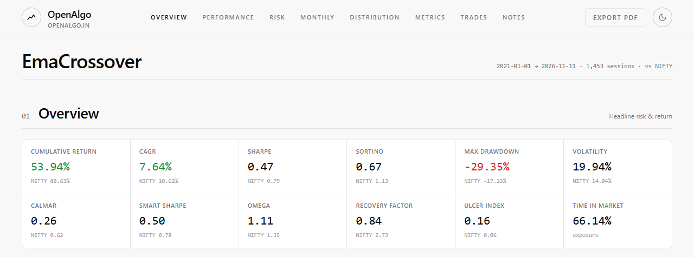
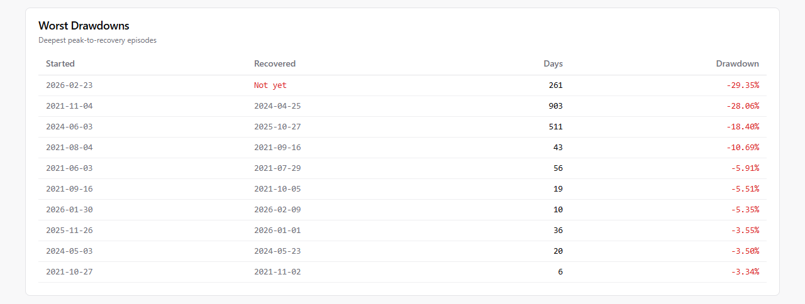
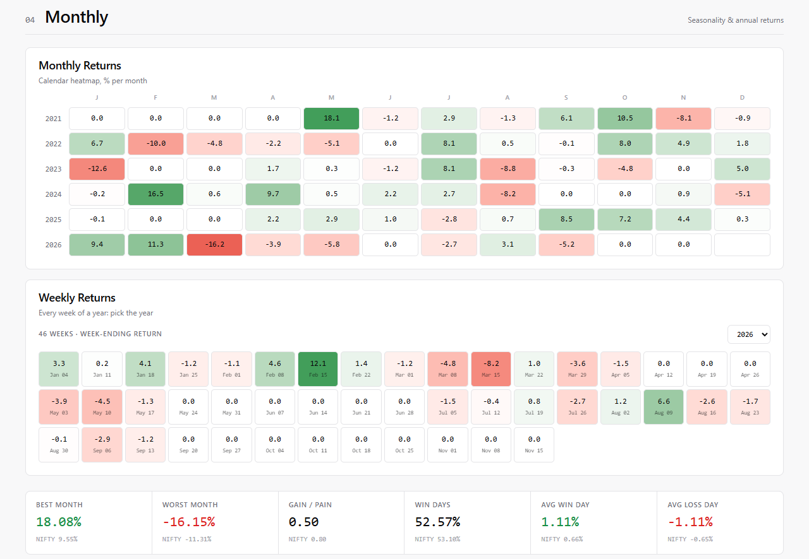
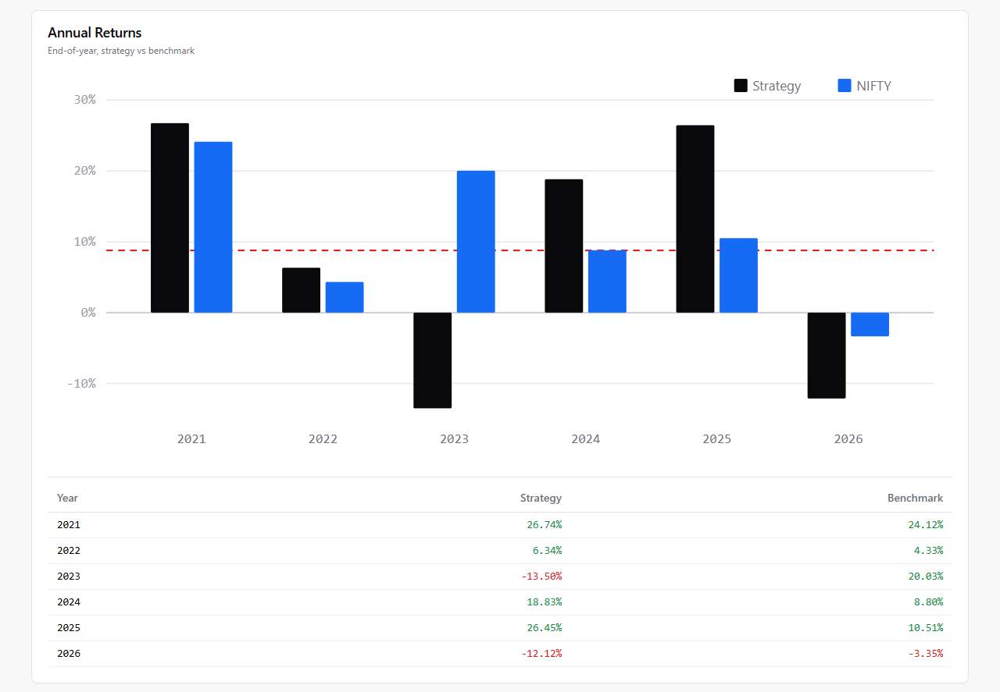
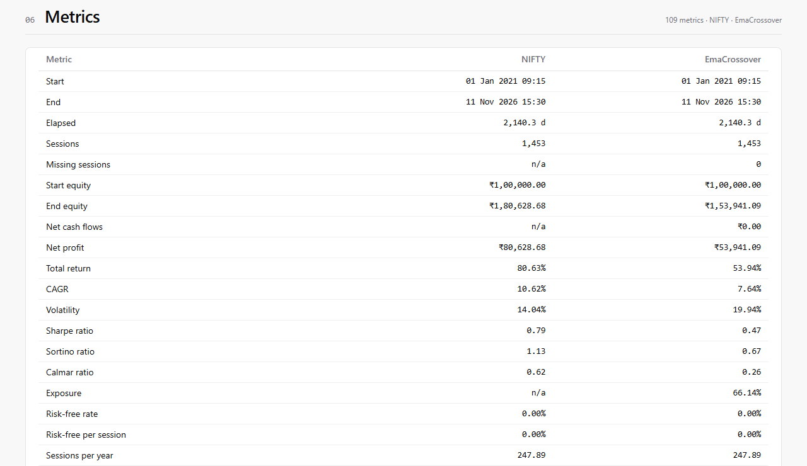
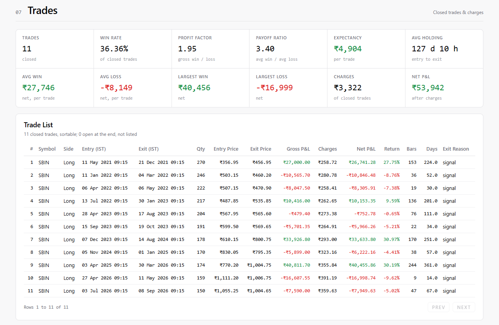
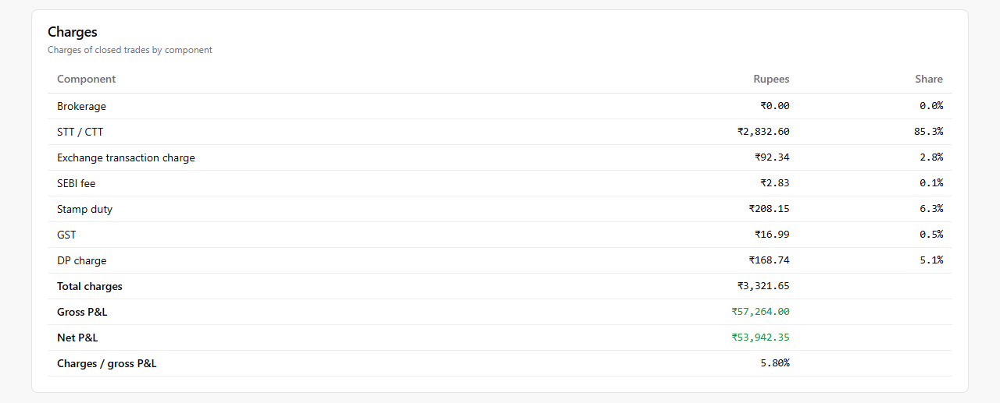

# The Tearsheet

A **tearsheet** is the full report of a backtest on one page that you open in your browser: every figure, every chart and every trade, with NIFTY's figures beside the strategy's when the run has a benchmark. This page makes the tearsheet of one real backtest and walks through it section by section, with a screenshot of each part.

## Make the tearsheet

The run is the EMA crossover of [Your First Backtest](tutorial/01-first-backtest.md): SBIN daily bars from 1 January 2021 to 11 November 2026, Rs 1,00,000 of capital, and NIFTY 50 as the benchmark (the index the strategy is compared with). Put the API key from your OpenAlgo dashboard in place of `OPENALGO_API_KEY`.

<!-- requires-server -->
```python
# Load the backtesting engine (bt), the OpenAlgo client (api) and the indicators (ta).
import openalgo.backtest as bt
from openalgo import api, ta

# Connect to your OpenAlgo server.
client = api(api_key="OPENALGO_API_KEY", host="http://127.0.0.1:5000")


# The strategy of lesson 1. A class groups the strategy's settings and steps under one name.
class EmaCrossover(bt.Strategy):
    symbol, exchange, interval = "SBIN", "NSE", "D"  # SBIN on NSE, daily bars
    fast = 20  # days in the fast EMA
    slow = 50  # days in the slow EMA

    # init runs before the first bar. (def starts a method: steps that belong to the class.)
    def init(self):
        # self.I(...) makes an indicator line that the strategy can read at every bar.
        self.fast_ema = self.I(ta.ema, self.close, self.fast)  # 20-day EMA of the closes
        self.slow_ema = self.I(ta.ema, self.close, self.slow)  # 50-day EMA of the closes

    # on_bar runs at the close of every bar (here once a day) and decides what to do.
    def on_bar(self, bar):
        # Buy when holding nothing (is_flat) and the fast EMA crosses above the slow EMA.
        if self.position.is_flat and self.fast_ema.crossed_above(self.slow_ema):
            self.buy()  # with all the capital, at the next day's open
        # Sell when holding shares (is_long) and the fast EMA crosses back below.
        elif self.position.is_long and self.fast_ema.crossed_below(self.slow_ema):
            self.exit()  # sell all the shares at the next day's open


# Run the backtest, with NIFTY 50 as the benchmark.
result = bt.backtest(EmaCrossover, client, start="2021-01-01", end="2026-11-11", capital=100_000,
                     benchmark="NIFTY")

# Write the tearsheet to the file sbin.html, in the folder you ran this code from.
path = result.tearsheet("sbin.html")
print("Open", path, "in your browser")
```

<!-- output -->
```text
Open sbin.html in your browser
```

Open `sbin.html` with a double-click, or drag it into your browser. Everything is inside the one file: it opens without an internet connection, and you can email it or keep it with your notes. It holds the results and the settings of the run, never your API key.

The page has eight numbered sections, one under the other. The rest of this page shows each of them for this run. To learn what a figure means, see [Metrics Explained](metrics-explained.md).

## The header and the Overview

<figure><figcaption><p>The header and the Overview</p></figcaption></figure>

The **header** stays at the top of the window while you scroll:

* The section names (Overview, Performance, Risk and so on) jump to each section.
* **Export PDF** opens your browser's print window; choose "Save as PDF" there to keep a PDF copy. The header is left out of the printout.
* The round button on the right switches the page between light and dark.

Under the header are the strategy's name (its class name, `EmaCrossover`), the dates of the run, the number of trading days (sessions) and the benchmark.

The **Overview** has twelve tiles, the headline figures of the run. The large number is the strategy's; the small line under it, such as "NIFTY 80.63%", is the same figure for simply holding NIFTY over the same dates. Green is a gain and red a loss.

Here the tiles already tell the story of this run. The strategy returned 53.94 percent, 7.64 percent a year, while NIFTY returned 80.63 percent, 10.62 percent a year. Its worst fall was -29.35 percent against NIFTY's -17.23 percent, and its Sharpe ratio was 0.47 against NIFTY's 0.79. It spent 66.14 percent of the time in the market ("Time in market") and the rest in cash.

## Performance

<figure><figcaption><p>Performance: the cumulative return and the rolling charts</p></figcaption></figure>

**Cumulative Return** is the most important chart of the report. It shows how much the account had grown since the start, in percent, day by day:

* The **black line** (with grey shading under it) is the strategy; the **blue line** is NIFTY.
* A flat stretch of the black line is a time the strategy held no shares, only cash.
* Here the strategy climbed to about 120 percent early in 2026, then fell back to 53.94 percent. That fall is the max drawdown of the Overview.

Hover over a chart with the mouse to read its values on any day.

The three charts below it are **rolling** figures: each point is measured over the 124 trading days (about six months) before it, so you can see how the strategy behaved at different times:

* **Rolling Sharpe:** the return per unit of ups and downs over each half year. Above 0, that half year made money.
* **Rolling Volatility:** how much the account swung over each half year.
* **Rolling Win Rate:** the share of days on which the account rose.

A strategy whose rolling Sharpe is high in one short stretch and low everywhere else made its money in that one stretch: ask whether it would happen again.

<figure><figcaption><p>Performance: return and risk over the last 1, 3 and 5 years</p></figcaption></figure>

**Return & Risk by Horizon** gives the CAGR (return per year), the max drawdown and the Sharpe ratio over the last year, the last 3 and 5 years, and the whole run. Here the last year lost 9.52 percent with a Sharpe of -0.42, while the last 3 years made 11.51 percent a year. A strategy that did well over the whole run but badly in the latest year is worth a closer look before you trade it.

## Risk

<figure><figcaption><p>Risk: the drawdown chart and the risk figures</p></figcaption></figure>

The red **Drawdown** chart shows how far the account was below its highest value so far, every day. At 0 the account stood at a new high; the deeper the red, the bigger the fall. The two deep valleys here are the falls of late 2021 to 2023 and of 2026.

The tiles under it are the risk figures: the max drawdown, the conditional drawdown (the average of the deepest falls), the longest drawdown in days (903 here, against NIFTY's 463), the value at risk and expected shortfall of a single day, the volatility, the risk of ruin, the skew, the kurtosis and the tail ratio. The row "VS BENCHMARK - NIFTY" compares the strategy with NIFTY: beta, alpha, correlation, R squared, information ratio and Treynor ratio. Alpha is shown as a fraction: 0.02 is about 2 percent a year (1.55 percent before rounding).

Below the tiles, **Rolling Beta** draws the beta over each half year: how closely the strategy followed NIFTY at each time.

<figure><figcaption><p>Risk: the ten worst drawdowns</p></figcaption></figure>

**Worst Drawdowns** lists the ten deepest falls: when each started, when the account got back to its earlier high ("Not yet" when it has not), how many days that took, and how deep it went. Here the worst fall, -29.35 percent, began on 23 February 2026 and had not recovered by the end of the run. The second, -28.06 percent, began on 4 November 2021 and took 903 days to recover. Read this table as a question: could you have waited two and a half years for the account to recover?

At the end of the section, **Consecutive Losing Streaks** counts how often the account fell on 1, 2, 3 or more days in a row. Here the longest run of falling days was 7.

## Monthly

<figure><figcaption><p>Monthly: the month and week heatmaps</p></figcaption></figure>

**Monthly Returns** is a heatmap: one row per year, one cell per month, with the month's return in percent. Green cells are gains and red cells losses; the stronger the colour, the bigger the move. A 0.0 cell is a month the strategy spent in cash. Look for patterns: a strategy that makes all its money in two or three months has had a lucky streak, not a steady edge.

**Weekly Returns** shows every week of one year the same way. Pick the year from the list at its top right.

The tiles under them give the best and worst month, the gain to pain ratio, the share of rising days ("Win days") and the average rising and falling day, each with NIFTY's figure.

<figure><figcaption><p>Monthly: each year against NIFTY</p></figcaption></figure>

**Annual Returns** compares each calendar year: the black bar is the strategy and the blue bar NIFTY. The dashed red line is the strategy's average year. The table under it gives the numbers. Here 2023 stands out: the strategy lost 13.50 percent while NIFTY gained 20.03 percent.

## Distribution

<figure><figcaption><p>Distribution: how the daily returns were spread</p></figcaption></figure>

This section shows how big the daily moves were:

* The tiles give the best and worst day (8.93 and -14.20 percent here, against NIFTY's 4.74 and -5.93), the skew, the kurtosis and the outlier ratios. [Metrics Explained](metrics-explained.md#tail-risk) explains them.
* **Daily Returns** is a histogram: each bar counts the days whose return fell in its range, green above zero and red below. The tall bar at 0 is the many days spent in cash. The dashed line marks the average day.
* **Returns Spread** draws the daily and the monthly returns as box plots. The line runs from the lowest to the highest value, the box holds the middle half of the days (or months), and the mark inside it is the middle one, the median. A green box has a median above zero, a red one below.

## Metrics

<figure><figcaption><p>Metrics: every figure, NIFTY beside the strategy</p></figcaption></figure>

**Metrics** lists every figure of the run in one table, 109 here, with NIFTY's value in one column and the strategy's in the next. "n/a" means the figure does not apply to the index, such as the exposure of a buy-and-hold. Click a column heading to sort the table by it. The figures are the same as in `result.metrics_table()`; [Metrics Explained](metrics-explained.md) explains each one.

## Trades

<figure><figcaption><p>Trades: the trade figures and the trade list</p></figcaption></figure>

The tiles sum up the closed trades: how many, the win rate, the profit factor, the payoff ratio, the expectancy (the average profit per trade), the average holding time (127 days and 10 hours here), the average and largest win and loss, the charges and the net P&L.

The **Trade List** has one row per closed trade, the same rows as `result.trade_list()`: when each trade was bought and sold (in IST), the quantity, the prices, the profit before charges (gross P&L), the charges, the profit after them (net P&L), the return, how long it was held in bars and in days, and why it closed (`signal` is the strategy's own `self.exit()`). Click a column heading to sort the trades by it, for example by net P&L to see the best and worst trades first. A long list is split into pages; Prev and Next at the bottom move between them.

<figure><figcaption><p>Trades: the charges, item by item</p></figcaption></figure>

**Charges** splits what the trades paid into each charge, in rupees and as a share of the total. For delivery (CNC) trades like these, STT is most of it: Rs 2,832.60 of Rs 3,321.65. In all, charges took 5.80 percent of the gross profit. The trade figures come before the rounding of each day's contract note, which is why the net P&L here is Rs 1.26 more than the net profit of the run (see [Metrics Explained](metrics-explained.md#trades)).

When a strategy opens trades with a stop-loss, this section also has an **R-multiples** table: each trade's profit or loss in units of what its stop-loss risked.

## Notes

<figure><figcaption><p>Notes: how the figures were worked out, and the settings of the run</p></figcaption></figure>

**How the figures were computed** says how returns are measured, how they are turned into yearly figures (here with 247.89 trading days a year from the NSE calendar) and the risk-free rate used.

**Assumptions** lists every setting the run used, the same lines as `print(result)` ([Read the Results](tutorial/02-read-the-results.md#what-the-engine-assumed-for-you) explains them), and ends with every warning of the run, in red. Read the warnings before you trust the figures.

## Light and dark

<figure><figcaption><p>The same tearsheet in the dark theme</p></figcaption></figure>

The tearsheet first follows your computer's light or dark setting. The round button at the top right switches it.

## A shorter report

`mode=` writes only a part of the page. This block continues the one at the top:

<!-- requires-server -->
<!-- continues -->
```python
# A shorter report with the headline sections only.
path = result.tearsheet("sbin_basic.html", mode="basic")
print("Open", path, "in your browser")
```

<!-- output -->
```text
Open sbin_basic.html in your browser
```

| `mode=` | What the page holds |
|---|---|
| `"full"` (the default) | Every section |
| `"basic"` | The Overview, the cumulative return and the returns by horizon, the drawdown chart and the worst drawdowns, the monthly heatmap and the yearly returns, the trades and charges, and the Notes |
| `"metrics"` | Every figure with its value and definition, and the settings the run used |
| `"charts"` | Every chart and nothing else |

## What to look at first

1. **The Overview tiles:** the return, the CAGR and the max drawdown, each against NIFTY.
2. **The cumulative return chart:** did the account grow steadily, or in one lucky stretch?
3. **The worst drawdowns:** how deep the falls went and how long they took to recover. Could you have held on?
4. **The annual returns:** did the strategy make money in most years, or in one or two?
5. **The trade list:** did the profit come from many trades or from a few?
6. **The warnings** at the end of the Notes.

## More options

* `log_scale=True` draws the cumulative return on a log scale, which reads better on long runs with large gains.
* Without a path, `result.tearsheet()` returns the page as text instead of writing a file.
* A tearsheet of figures you computed yourself: `openalgo.backtest.report.tearsheet(performance, path)`. See [Metrics](support-functions/metrics.md).
* Every table behind the tearsheet, as pandas DataFrames: [Results and Reports](results-and-reports.md).
